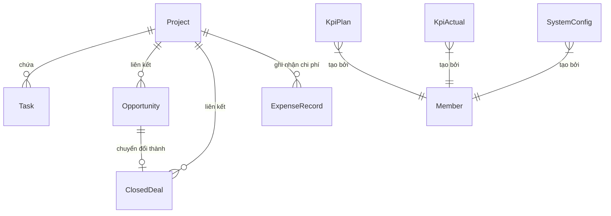

# Tài liệu chi tiết: Module 2 - Quản lý Dự án & Công việc (Projects & Tasks)

Tài liệu này cung cấp hướng dẫn onboarding và đặc tả kỹ thuật cực kỳ chi tiết cho từng API trong module **Projects & Tasks**. Mọi Endpoint đều được làm rõ về File code xử lý, Dữ liệu đầu vào (Input), Dữ liệu phản hồi (Output) và các ràng buộc nghiệp vụ (Business Rules).

---

## 💡 1. Bối cảnh nghiệp vụ (Business Context)

Module này giải quyết 4 bài toán quản trị chính của Marketing Hub:
1. **Quản lý Dự án (Projects):** Thiết lập thông tin cơ bản, quản lý ngân sách và so sánh các chỉ tiêu KPI (Kế hoạch vs Thực tế) theo từng dự án.
2. **Quy trình công việc (Task Workflow):** Quản lý tiến độ công việc qua Kanban Board với các trạng thái nghiệp vụ chặt chẽ, hỗ trợ phân cấp độ ưu tiên, đính kèm tài liệu và phân vai trò người liên quan (Stakeholders).
3. **Báo cáo Tuần tự động (Weekly Reports):** Tổng hợp tự động các công việc đã làm trong tuần, kế hoạch tuần tới, các vấn đề tồn đọng (Backlog) và những điểm cần Ban giám đốc (BOD) hỗ trợ.
4. **Tối ưu hóa thao tác (Automation & Import):** Tự động sinh danh mục công việc chuẩn (Checklist Template) khi tạo các dự án sự kiện; hỗ trợ nhập nhanh danh sách công việc hàng loạt từ file Excel/CSV.

---

## 🗄️ 2. Sơ đồ dữ liệu & Mối quan hệ liên quan (Database Schema Relationships)



* **`Project`**: Lưu thông tin các dự án. Chỉ các dự án có `status: "Active"` mới được dùng để tổng hợp trên Dashboard, tuy nhiên module này quản lý tất cả trạng thái của dự án.
* **`Task`**: Các đầu việc cụ thể trong dự án, liên kết trực tiếp với dự án thông qua `projectId` và người phụ trách thông qua `assigneeId`.
* **`Member`**: Lưu trữ danh sách thành viên trong hệ thống (với vai trò `manager` hoặc `specialist`).
* **`WeeklyReportLog`**: Lưu trữ các ghi chú tự do dạng văn bản (Done, Plan, Backlog, BOD Support) được cập nhật thủ công bởi người quản lý cho mỗi tuần.

---

## 🛠️ 3. Các quy tắc nghiệp vụ đặc trưng

### A. Tự động sinh Checklist cho dự án Sự kiện (Event Template Checklist)
* **Loại dự án áp dụng:** `Workshop`, `Event`, `Exhibition`, `Webinar`.
* **Thuật toán phân bổ thời gian:**
  * Hệ thống có sẵn danh sách 11 đầu việc chuẩn (`EVENT_CHECKLIST`).
  * Khi tạo dự án với cờ `applyTemplate: true`, hệ thống sẽ tính khoảng cách thời gian từ lúc tạo đến `deadline`.
  * Các đầu việc sẽ được phân bổ hạn chót (`dueDate`) rải đều theo tỉ lệ tuyến tính từ $1/11$ đến $11/11$ khoảng thời gian đó.
  * Mỗi công việc sẽ tự động được tính tuần ISO (`execWeek`) và năm (`execYear`) dựa trên ngày hạn chót được phân bổ.
  * **Tính toàn vẹn (Transaction):** Nếu việc tạo bất kỳ Task nào trong Template bị lỗi, hệ thống sẽ thực hiện rollback toàn bộ (xóa dự án vừa tạo) để đảm bảo không bị rác dữ liệu.
* **Chi tiết File & Dòng code:**
  * Hàm sinh checklist: [createEventChecklist trong projects.service.ts (Line 163-192)](../src/modules/projects-tasks/projects.service.ts#L163-L192)

### B. Logic sắp xếp mức độ ưu tiên hiển thị Task (Sorting Rank)
Khi lấy danh sách Task, hệ thống tự động sắp xếp theo thứ tự ưu tiên giảm dần về độ khẩn cấp (giúp lập trình viên FE không cần viết lại logic sắp xếp):
1. **Ưu tiên 1 (Rank 0):** Công việc đã quá hạn (`isOverdue = true`).
2. **Ưu tiên 2 (Rank 1):** Công việc sắp đến hạn trong vòng 5 ngày (`isUpcoming = true`).
3. **Ưu tiên 3 (Rank 2):** Công việc đang làm (`In Progress`).
4. **Ưu tiên 4 (Rank 3):** Công việc cần làm (`To Do`).
5. **Ưu tiên 5 (Rank 4):** Công việc chờ duyệt (`Review`).
6. **Ưu tiên 6 (Rank 5):** Các trạng thái khác.
* *Sắp xếp phụ:* Nếu cùng hạng ưu tiên, Task nào có hạn chót (`dueDate`) gần hơn sẽ xếp lên trước.
* **Chi tiết File & Dòng code:**
  * Hàm xếp hạng sắp xếp: [sortRank trong tasks.service.ts (Line 197-204)](../src/modules/projects-tasks/tasks.service.ts#L197-L204)

### C. Quy tắc tính toán Thời gian & Validate Task (BE-02 & BE-05)
* **Tính toán Tuần & Năm tự động:** Khi tạo/cập nhật Task, nếu client không truyền `execWeek` hoặc `execYear`, hệ thống tự động suy ra số tuần chuẩn ISO và năm từ hạn chót (`dueDate`).
* **Tính thời lượng thực hiện (`durationWeeks`):** Được tính theo công thức:
  $$\text{durationWeeks} = \left\lceil \frac{\text{dueDate} - \text{startDate}}{7 \times 24 \times 60 \times 60 \times 1000} \right\rceil$$
  Nếu không có `startDate`, `durationWeeks` mặc định là 1 tuần.
* **Validate thứ tự ngày tháng:** Ràng buộc `dueDate >= startDate`. Nếu `dueDate < startDate`, hệ thống ném `BadRequestException` kèm thông báo: *"Hạn chót (due_date) phải lớn hơn hoặc bằng ngày bắt đầu (start_date)"*.
* **Kiểm tra trạng thái người phụ trách (BE-03):** Khi gán hoặc đổi `assigneeId`, hệ thống kiểm tra thành viên phải tồn tại và `isActive === true`.
* **Lọc Task theo Dự án (BE-05):** Endpoint `GET /v1/tasks` hỗ trợ `projectId` query parameter để lọc danh sách task theo từng dự án cụ thể.

### D. Cơ chế Import Task từ Excel/CSV dạng 2 bước (Dry-run & Commit)
Để tránh lỗi định dạng khi import file dữ liệu lớn, API Import hoạt động theo cơ chế an toàn:
* **Bước 1 (Dry-run) - `confirm: false`:**
  * Parse file CSV/XLSX. Kiểm tra tính hợp lệ của từng dòng: Tên dự án có tồn tại không? Người phụ trách (`assignee`) có trong hệ thống không? Định dạng ngày tháng, số tuần có đúng không?
  * Không ghi vào database. Chỉ trả về kết quả kiểm tra gồm: Tổng số dòng, số dòng hợp lệ, số dòng lỗi và mảng chi tiết lỗi của từng dòng.
* **Bước 2 (Commit) - `confirm: true`:**
  * Hệ thống kiểm tra lại, nếu vẫn còn dòng lỗi sẽ chặn lại ngay lập tức và ném lỗi `BadRequestException`.
  * Nếu 100% dữ liệu hợp lệ, hệ thống sẽ chạy vòng lặp tạo Task trong database và ghi nhận nhật ký import vào bảng `ImportLog`.
* **Chi tiết File & Dòng code:**
  * Hàm parse & validate file: [parse trong task-import.service.ts (Line 18-137)](../src/modules/projects-tasks/task-import.service.ts#L18-L137)

---

## 🚀 4. Đặc tả chi tiết từng API Endpoint

### 🔐 Yêu cầu xác thực chung
Tất cả các API dưới đây đều yêu cầu đính kèm Header `Authorization: Bearer <JWT_TOKEN>`.
Các guard áp dụng: `JwtAuthGuard`, `RolesGuard`.

---

### PHÂN NHÓM A: QUẢN LÝ DỰ ÁN (PROJECTS)
Đường dẫn cơ sở: `/v1/projects`

#### API 1: Lấy danh sách tất cả các dự án
* **Endpoint:** `GET /v1/projects`
* **File Controller:** [projects.controller.ts:Line 27-30](../src/modules/projects-tasks/projects.controller.ts#L27-L30) $\rightarrow$ `findAll()`
* **File Service:** [projects.service.ts:Line 50-64](../src/modules/projects-tasks/projects.service.ts#L50-L64) $\rightarrow$ `findAll()`
* **Input (Query Params):** Không có.
* **Output:** Mảng chứa danh sách dự án kèm thông tin tổng hợp KPIs, ngân sách và tiến độ:
  ```json
  [
    {
      "id": "8e3c79a4-2e92-4fdb-85d9-366a3d1dfcfc",
      "name": "Chiến dịch Thương hiệu Q3",
      "type": "Client", // Loại dự án: Internal, Client, Research, Workshop, Event, Exhibition, Webinar
      "status": "Active", // Trạng thái: Planning, Active, On Hold, Completed, Cancelled
      "ownerId": "member-uuid-1",
      "deadline": "2026-09-30T17:00:00.000Z",
      "budgetPlanDirect": 50000000,
      "budgetPlanOverhead": 10000000,
      "actualCostDirect": 45000000,
      "actualCostOverhead": 12000000,
      "createdBy": "admin-uuid",
      "createdAt": "2026-07-16T08:00:00.000Z",
      "updatedAt": "2026-07-16T08:00:00.000Z",
      "budgetPlanTotal": 60000000,
      "actualCostTotal": 57000000,
      "owner": {
        "id": "member-uuid-1",
        "name": "Nguyễn Văn A",
        "avatarUrl": "https://avatar.com/a.png"
      },
      "tasks": [
        {
          "id": "task-uuid-1",
          "name": "Lên Outline kế hoạch",
          "dueDate": "2026-07-20T17:00:00.000Z",
          "assignee": {
            "id": "member-uuid-2",
            "name": "Trần Thị B",
            "avatarUrl": null
          }
        }
      ],
      "kpis": [
        { "key": "rawLeads", "plan": 100, "actual": 85, "percent": 85.0 },
        { "key": "mql", "plan": 50, "actual": 40, "percent": 80.0 },
        { "key": "sql", "plan": 30, "actual": 20, "percent": 66.7 },
        { "key": "opp", "plan": 15, "actual": 10, "percent": 66.7 },
        { "key": "closedDeal", "plan": 5, "actual": 4, "percent": 80.0 },
        { "key": "pipelineValue", "plan": 200000000, "actual": 150000000, "percent": 75.0 }
      ],
      "progress": {
        "percentage": 80.0,
        "total": 5,
        "done": 4,
        "processing": 1,
        "overdue": 0
      }
    }
  ]
  ```

#### API 2: Lấy chi tiết một dự án theo ID
* **Endpoint:** `GET /v1/projects/:id`
* **File Controller:** [projects.controller.ts:Line 32-35](../src/modules/projects-tasks/projects.controller.ts#L32-L35) $\rightarrow$ `findOne()`
* **File Service:** [projects.service.ts:Line 66-81](../src/modules/projects-tasks/projects.service.ts#L66-L81) $\rightarrow$ `findOne()`
* **Input (Param):** `id` *(string, UUID, required)* - ID dự án.
* **Output:** Đối tượng duy nhất tương tự như cấu trúc phần tử của API 1 nhưng lọc riêng theo ID.

#### API 3: Tạo mới một dự án
* **Endpoint:** `POST /v1/projects`
* **File Controller:** [projects.controller.ts:Line 37-43](../src/modules/projects-tasks/projects.controller.ts#L37-L43) $\rightarrow$ `create()`
* **File Service:** [projects.service.ts:Line 83-116](../src/modules/projects-tasks/projects.service.ts#L83-L116) $\rightarrow$ `create()`
* **Input (Body):** `CreateProjectDto`
  ```json
  {
    "name": "Chiến dịch Viral TikTok",
    "type": "Client", // Bắt buộc: 'Internal' | 'Client' | 'Research' | 'Workshop' | 'Event' | 'Exhibition' | 'Webinar'
    "status": "Planning", // Bắt buộc: 'Planning' | 'Active' | 'On Hold' | 'Completed' | 'Cancelled'
    "ownerId": "8e3c79a4-2e92-4fdb-85d9-366a3d1dfcfc",
    "deadline": "2026-08-30",
    "applyTemplate": true,
    "budgetPlanDirect": 15000000,
    "budgetPlanOverhead": 5000000,
    "kpiRawLeadsPlan": 500,
    "kpiMqlPlan": 200
  }
  ```
* **Output:** Đối tượng dự án vừa được tạo thành công kèm đầy đủ các thông tin tính toán tương tự API 1.

#### API 4: Cập nhật thông tin dự án
* **Endpoint:** `PATCH /v1/projects/:id`
* **File Controller:** [projects.controller.ts:Line 45-51](../src/modules/projects-tasks/projects.controller.ts#L45-L51) $\rightarrow$ `update()`
* **File Service:** [projects.service.ts:Line 118-135](../src/modules/projects-tasks/projects.service.ts#L118-L135) $\rightarrow$ `update()`
* **Input (Param):** `id` *(string, UUID, required)*
* **Input (Body):** `UpdateProjectDto` (Là Partial của `CreateProjectDto`).
* **Output:** Đối tượng dự án sau khi cập nhật thành công.

#### API 5: Xóa một dự án (Lưu trữ / Soft Delete)
* **Endpoint:** `DELETE /v1/projects/:id`
* **File Controller:** [projects.controller.ts:Line 53-58](../src/modules/projects-tasks/projects.controller.ts#L53-L58) $\rightarrow$ `remove()`
* **File Service:** [projects.service.ts:Line 137-153](../src/modules/projects-tasks/projects.service.ts#L137-L153) $\rightarrow$ `remove()`
* **Tác dụng:** Chuyển dự án và toàn bộ Task thuộc dự án sang trạng thái **Lưu trữ (Soft Delete)** bằng cách ghi nhận thời gian `archivedAt` và ID người thực hiện `archivedBy`. Dữ liệu sẽ ẩn khỏi danh sách nhưng không bị xóa vĩnh viễn khỏi Database.
* **Input (Param):** `id` *(string, UUID, required)*
* **Output:**
  ```json
  {
    "message": "Lưu trữ (Soft delete) project thành công"
  }
  ```

---

### PHÂN NHÓM B: QUẢN LÝ CÔNG VIỆC (TASKS)
Đường dẫn cơ sở: `/v1/tasks`

#### API 6: Lấy danh sách công việc (Kèm Bộ Lọc & Thống Kê)
* **Endpoint:** `GET /v1/tasks`
* **File Controller:** [tasks.controller.ts:Line 37-40](../src/modules/projects-tasks/tasks.controller.ts#L37-L40) $\rightarrow$ `findAll()`
* **File Service:** [tasks.service.ts:Line 29-41](../src/modules/projects-tasks/tasks.service.ts#L29-L41) $\rightarrow$ `findAll()`
* **Input (Query Params):** `TaskFilterDto`
  * `projectId` *(string, optional)*
  * `status` *(string, optional)*
  * `priority` *(string, optional)*
  * `assigneeId` *(string, optional)*
  * `dueDateFrom` *(string, ISO Date, optional)*
  * `dueDateTo` *(string, ISO Date, optional)*
* **Output:**
  ```json
  {
    "data": [
      {
        "id": "task-uuid-1",
        "name": "Thiết kế Banner Facebook Ads",
        "description": "Yêu cầu tone màu xanh dương chủ đạo",
        "projectId": "project-uuid-1",
        "assigneeId": "member-uuid-2",
        "status": "In Progress",
        "priority": "High",
        "startDate": "2026-07-15T00:00:00.000Z",
        "dueDate": "2026-07-20T17:00:00.000Z",
        "completedDate": null,
        "execWeek": 30,
        "execYear": 2026,
        "reason": null,
        "neededSupportBod": null,
        "link": "https://figma.com/design-file",
        "remark": null,
        "createdAt": "2026-07-15T08:00:00.000Z",
        "updatedAt": "2026-07-16T08:00:00.000Z",
        "project": {
          "id": "project-uuid-1",
          "name": "Chiến dịch Thương hiệu Q3",
          "type": "Client"
        },
        "assignee": {
          "id": "member-uuid-2",
          "name": "Trần Thị B",
          "avatarUrl": null
        },
        "stakeholders": ["BOD", "Sales Team"],
        "isOverdue": false,
        "isUpcoming": true
      }
    ],
    "stats": {
      "total": 1,
      "To Do": 0,
      "In Progress": 1,
      "Review": 0,
      "overdue": 0,
      "upcoming": 1
    }
  }
  ```

#### API 7: Lấy dữ liệu công việc nhóm theo cột Kanban (Kanban Board)
* **Endpoint:** `GET /v1/tasks/kanban/board`
* **File Controller:** [tasks.controller.ts:Line 42-45](../src/modules/projects-tasks/tasks.controller.ts#L42-L45) $\rightarrow$ `kanban()`
* **File Service:** [tasks.service.ts:Line 55-64](../src/modules/projects-tasks/tasks.service.ts#L55-L64) $\rightarrow$ `kanban()`
* **Input (Query Params):** `TaskFilterDto`.
* **Output:**
  ```json
  [
    {
      "status": "To Do",
      "count": 1,
      "tasks": [
        {
          "id": "task-uuid-2",
          "name": "Viết Content cho bài viết PR",
          "dueDate": "2026-07-22T17:00:00.000Z",
          "status": "To Do"
        }
      ]
    }
  ]
  ```

#### API 8: Tải file mẫu CSV để chuẩn bị dữ liệu Import Tasks
* **Endpoint:** `GET /v1/tasks/import/template`
* **File Controller:** [tasks.controller.ts:Line 47-56](../src/modules/projects-tasks/tasks.controller.ts#L47-L56) $\rightarrow$ `template()`
* **File Service:** [task-import.service.ts:Line 139-144](../src/modules/projects-tasks/task-import.service.ts#L139-144) $\rightarrow$ `template()`
* **Headers phản hồi:**
  * `Content-Type: text/csv; charset=utf-8`
  * `Content-Disposition: attachment; filename="task-import-template.csv"`

#### API 9: Nhập danh sách công việc hàng loạt từ file CSV/Excel
* **Endpoint:** `POST /v1/tasks/import`
* **File Controller:** [tasks.controller.ts:Line 58-97](../src/modules/projects-tasks/tasks.controller.ts#L58-L97) $\rightarrow$ `import()`
* **File Service:** [task-import.service.ts:Line 18-137](../src/modules/projects-tasks/task-import.service.ts#Line 18-137) $\rightarrow$ `parse()`
* **Headers yêu cầu:** `Content-Type: multipart/form-data`
* **Input (Multipart Body):**
  * `file` *(file binary, bắt buộc)*: File định dạng `.csv` hoặc `.xlsx`.
  * `projectId` *(string, optional)*.
  * `confirm` *(string/boolean, optional)*.
* **Cơ chế mô tả chi tiết bằng Swagger Swagger Annotation (ApiBody):**
  * Trường `file`: format binary.
  * Trường `projectId`: string UUID của dự án (tùy chọn).
  * Trường `confirm`: boolean, mặc định false (true = lưu vào DB, false = preview không lưu).
* **Output khi confirm = false:**
  ```json
  {
    "totalRows": 15,
    "validRows": 13,
    "errorRows": 2,
    "preview": [
      {
        "row": 2,
        "errors": [],
        "data": { "name": "Task hợp lệ 1", "projectId": "...", "status": "To Do" }
      }
    ],
    "errors": [
      {
        "row": 3,
        "errors": [ "assignee không hợp lệ hoặc không tồn tại" ],
        "data": { "name": "Task lỗi", "projectId": "..." }
      }
    ]
  }
  ```

#### API 10: Lấy chi tiết công việc theo ID
* **Endpoint:** `GET /v1/tasks/:id`
* **File Controller:** [tasks.controller.ts:Line 99-102](../src/modules/projects-tasks/tasks.controller.ts#L99-L102) $\rightarrow$ `findOne()`
* **File Service:** [tasks.service.ts:Line 43-53](../src/modules/projects-tasks/tasks.service.ts#L43-53) $\rightarrow$ `findOne()`
* **Input (Param):** `id` *(string, UUID, required)*
* **Output:** Đối tượng chi tiết của Task (cấu trúc tương tự như phần tử dữ liệu của API 6).

#### API 11: Tạo mới một công việc
* **Endpoint:** `POST /v1/tasks`
* **File Controller:** [tasks.controller.ts:Line 104-107](../src/modules/projects-tasks/tasks.controller.ts#L104-L107) $\rightarrow$ `create()`
* **File Service:** [tasks.service.ts:Line 66-73](../src/modules/projects-tasks/tasks.service.ts#L66-L73) $\rightarrow$ `create()`
* **Input (Body):** `CreateTaskDto`
  ```json
  {
    "name": "Thiết kế banner Facebook Ads",
    "projectId": "8e3c79a4-2e92-4fdb-85d9-366a3d1dfcfc",
    "assigneeId": "member-uuid-2",
    "priority": "Medium",
    "dueDate": "2026-07-20",
    "execWeek": 30,
    "execYear": 2026,
    "status": "To Do",
    "description": "Banner giới thiệu sản phẩm mới",
    "stakeholders": ["BOD", "CS Team"],
    "startDate": "2026-07-15"
  }
  ```
* **Output:** Đối tượng Task vừa tạo thành công.

#### API 12: Cập nhật thông tin công việc
* **Endpoint:** `PATCH /v1/tasks/:id`
* **File Controller:** [tasks.controller.ts:Line 109-112](../src/modules/projects-tasks/tasks.controller.ts#L109-L112) $\rightarrow$ `update()`
* **File Service:** [tasks.service.ts:Line 75-102](../src/modules/projects-tasks/tasks.service.ts#L75-L102) $\rightarrow$ `update()`
* **Input (Param):** `id` *(string, UUID, required)*
* **Input (Body):** `UpdateTaskDto` (Partial của `CreateTaskDto`).
* **Output:** Đối tượng Task sau khi cập nhật.

#### API 13: Xóa công việc (Lưu trữ / Soft Delete)
* **Endpoint:** `DELETE /v1/tasks/:id`
* **File Controller:** [tasks.controller.ts:Line 114-119](../src/modules/projects-tasks/tasks.controller.ts#L114-L119) $\rightarrow$ `remove()`
* **File Service:** [tasks.service.ts:Line 101-116](../src/modules/projects-tasks/tasks.service.ts#L101-L116) $\rightarrow$ `remove()`
* **Tác dụng:** Chuyển công việc sang trạng thái **Lưu trữ (Soft Delete)** bằng cách ghi nhận thời gian `archivedAt` và ID người thực hiện `archivedBy`. Dữ liệu sẽ ẩn khỏi danh sách và bảng Kanban nhưng không bị xóa vĩnh viễn khỏi Database.
* **Input (Param):** `id` *(string, UUID, required)*
* **Output:**
  ```json
  {
    "message": "Lưu trữ (Soft delete) task thành công"
  }
  ```

---

### PHÂN NHÓM C: BÁO CÁO TUẦN (WEEKLY REPORTS)
Đường dẫn cơ sở: `/v1/weekly-reports`

#### API 14: Lấy dữ liệu báo cáo tuần
* **Endpoint:** `GET /v1/weekly-reports`
* **File Controller:** [weekly-reports.controller.ts:Line 26-29](../src/modules/projects-tasks/weekly-reports.controller.ts#L26-L29) $\rightarrow$ `getReport()`
* **File Service:** [weekly-reports.service.ts:Line 10-56](../src/modules/projects-tasks/weekly-reports.service.ts#L10-56) $\rightarrow$ `getReport()`
* **Input (Query Params):** `WeeklyReportQueryDto`
  * `week` *(number, required)*
  * `year` *(number, required)*
  * `projectId` *(string, optional)*.
  * `memberId` *(string, optional)*.
* **Output:** Dữ liệu báo cáo chia theo 4 mục của tuần:
  ```json
  {
    "title": "Weekly Report — Tuần 30/2026",
    "period": { "from": "2026-07-20T00:00:00.000Z", "to": "2026-07-26T00:00:00.000Z", "week": 30, "year": 2026 },
    "sections": {
      "done": [ /* Danh sách tasks hoàn thành trong tuần */ ],
      "nextWeekPlan": [ /* Danh sách tasks kế hoạch tuần sau */ ],
      "backlog": [ /* Danh sách tasks trễ hạn hoặc tồn đọng */ ],
      "bodSupport": [ /* Danh sách các công việc cần BOD hỗ trợ */ ]
    }
  }
  ```

#### API 15: Lưu/Cập nhật ghi chú cho báo cáo tuần
* **Endpoint:** `POST /v1/weekly-reports/logs`
* **File Controller:** [weekly-reports.controller.ts:Line 31-37](../src/modules/projects-tasks/weekly-reports.controller.ts#L31-L37) $\rightarrow$ `saveLog()`
* **File Service:** [weekly-reports.service.ts:Line 58-80](../src/modules/projects-tasks/weekly-reports.service.ts#L58-L80) $\rightarrow$ `saveLog()`
* **Input (Body):** `SaveWeeklyLogDto`
  ```json
  {
    "week": 30,
    "year": 2026,
    "projectId": null,
    "memberId": null,
    "doneNotes": "Nội dung cập nhật công việc hoàn thành...",
    "planNotes": "Kế hoạch tuần sau...",
    "backlogNotes": "Vấn đề tồn đọng...",
    "bodNotes": "Yêu cầu hỗ trợ..."
  }
  ```
* **Output:** Ghi chú (`WeeklyReportLog`) vừa được cập nhật hoặc tạo mới.

#### API 16: Xuất báo cáo tuần ra tệp văn bản (.txt)
* **Endpoint:** `GET /v1/weekly-reports/export.txt`
* **File Controller:** [weekly-reports.controller.ts:Line 39-52](../src/modules/projects-tasks/weekly-reports.controller.ts#L39-L52) $\rightarrow$ `exportText()`
* **File Service:** [weekly-reports.service.ts:Line 82-111](../src/modules/projects-tasks/weekly-reports.service.ts#L82-L111) $\rightarrow$ `exportText()`
* **Tác dụng:** Trả về file văn bản thô `.txt` đã định dạng.
* **Input (Query Params):** `WeeklyReportQueryDto`.

---

### PHÂN NHÓM D: QUẢN LÝ THÀNH VIÊN (MEMBERS)
Đường dẫn cơ sở: `/members`

#### API 17: Lấy danh sách tất cả thành viên trong hệ thống
* **Endpoint:** `GET /members`
* **File Controller:** [members.controller.ts:Line 23-39](../src/modules/projects-tasks/members.controller.ts#L23-L39) $\rightarrow$ `findAll()`
* **Output:**
  ```json
  [
    {
      "id": "member-uuid-1",
      "memberId": 1,
      "name": "Nguyễn Văn A",
      "email": "a.nguyen@company.com",
      "role": "manager",
      "avatarUrl": "https://avatar.com/a.png",
      "isActive": true
    }
  ]
  ```

#### API 18: Cập nhật vai trò (Role) của thành viên
* **Endpoint:** `PATCH /members/:id/role`
* **File Controller:** [members.controller.ts:Line 41-64](../src/modules/projects-tasks/members.controller.ts#L41-L64) $\rightarrow$ `updateRole()`
* **Phân quyền:** Chỉ `manager` mới được phép gọi.
* **Input (Param):** `id` *(string, required)*
* **Input (Body):** `UpdateRoleDto`
  ```json
  {
    "role": "manager"
  }
  ```
* **Output:**
  ```json
  {
    "id": "member-uuid-2",
    "name": "Trần Thị B",
    "email": "b.tran@company.com",
    "role": "manager"
  }
  ```

---

### PHÂN NHÓM E: QUẢN LÝ HỒ SƠ & HỢP ĐỒNG DỰ ÁN (PROJECT DOCUMENTS)
Đường dẫn cơ sở: `/api/v1/projects`

#### API 19: Lấy danh sách tài liệu của dự án
* **Endpoint:** `GET /api/v1/projects/:id/documents`
* **File Controller:** [project-documents.controller.ts](../src/modules/projects-tasks/project-documents.controller.ts)
* **File Service:** [project-documents.service.ts](../src/modules/projects-tasks/project-documents.service.ts) $\rightarrow$ `getProjectDocuments()`
* **Output:** Trả về danh sách tài liệu (đã lọc `archivedAt: null`), trong đó mỗi tài liệu luôn kèm theo trường `url` tuyệt đối để mở trực tiếp trong tab mới:
  ```json
  [
    {
      "id": "doc-uuid-1",
      "projectId": "proj-uuid-1",
      "fileName": "Hop_dong_dich_vu.pdf",
      "fileType": "pdf",
      "fileSize": 2048576,
      "url": "https://mkt-hub-be.onrender.com/api/v1/projects/documents/doc-uuid-1/file",
      "createdAt": "2026-08-23T10:00:00.000Z"
    }
  ]
  ```

#### API 20: Tải lên tài liệu mới cho dự án
* **Endpoint:** `POST /api/v1/projects/:id/documents`
* **Content-Type:** `multipart/form-data` (trường `file`)
* **File Controller:** [project-documents.controller.ts](../src/modules/projects-tasks/project-documents.controller.ts)
* **Output:** Bản ghi tài liệu vừa tạo kèm trường `url` tuyệt đối.

#### API 21: Xem hoặc tải file tài liệu (Streaming inline)
* **Endpoint:** `GET /api/v1/projects/documents/:id/file`
* **Mục đích:** Cho phép xem trực tiếp file PDF, hình ảnh hoặc tải về từ liên kết `<a target="_blank">`.
* **Cơ chế:**
  - Thiết lập Header `Content-Disposition: inline; filename="..."` và `Content-Type` chuẩn theo định dạng file.
  - Tự động kiểm tra xóa mềm: Nếu tài liệu hoặc dự án cha có `archivedAt != null`, API sẽ trả về mã lỗi `404 Not Found`.

#### API 22: Xóa mềm tài liệu dự án
* **Endpoint:** `DELETE /api/v1/projects/documents/:id`
* **Cơ chế:** Đánh dấu `archivedAt = new Date()`, vô hiệu hóa link truy cập file.

---

## 💡 5. Hướng dẫn sửa đổi code (Developer Guidelines)

1. **Cơ chế sinh URL tuyệt đối (Dynamic URL Resolution):**
   - Hệ thống tự động phân giải domain từ header của request (`x-forwarded-proto`, `host`) hoặc biến môi trường (`RENDER_EXTERNAL_URL`, `APP_URL`, `BACKEND_URL`). Nhờ vậy khi deploy Backend lên Render và Frontend lên Vercel, các đường link file luôn tự động chính xác mà không bị hardcode `localhost`.
2. **Transaction trong Prisma:**
   - Khi thực hiện các hành động tạo/xóa liên quan đến nhiều bảng cùng lúc (ví dụ: Xóa dự án đi kèm xóa task, hay Tạo dự án sự kiện đi kèm tạo checklist), hãy luôn bọc các câu lệnh trong `prisma.$transaction([])` để tránh tình trạng dữ liệu mồ côi (orphan records).
3. **Quy định bắt buộc nhập lý do (Reason Validation):**
   - Nếu bạn định nghĩa thêm trạng thái công việc mới trong file [projects-tasks.constants.ts](../src/modules/projects-tasks/projects-tasks.constants.ts) mà trạng thái đó cần giải trình lý do từ người dùng, nhớ cập nhật thêm điều kiện kiểm tra trong hàm [validateBusinessRules trong tasks.service.ts](../src/modules/projects-tasks/tasks.service.ts).
4. **Múi giờ khi Import Excel:**
   - Thư viện `exceljs` tự động nhận diện các cột định dạng Date. Tuy nhiên, khi chuyển sang database Postgres, hãy đảm bảo thời gian đã được chuẩn hóa sang chuỗi ISO UTC trước khi lưu để tránh lệch 1 ngày do lệch múi giờ local (+7).
