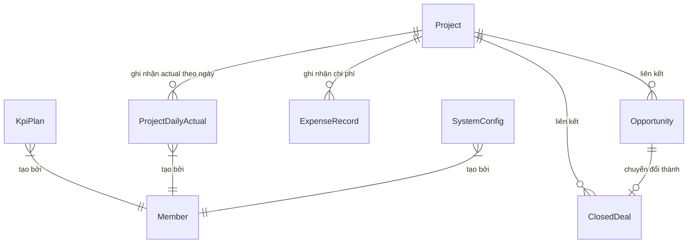

# Hướng dẫn & Đặc tả chi tiết: Module 3 - Lượng truy cập & KPIs (Leads & KPIs)

Tài liệu này cung cấp hướng dẫn onboarding và đặc tả kỹ thuật chi tiết cho từng API trong module **Leads & KPIs**. Module này chịu trách nhiệm quản lý mục tiêu kinh doanh cả năm (Annual KPI), phân bổ mục tiêu cố định cho từng dự án (Project KPI), ghi nhận kết quả thực tế phát sinh theo ngày (Daily Actuals), quản lý phễu bán hàng (Opportunities & Closed Deals) và phân tích hiệu quả tài chính.

---

## 💡 1. Bối cảnh nghiệp vụ (Business Context)

Module **Leads & KPIs** xử lý các bài toán nghiệp vụ cốt lõi sau:
1. **Thiết lập mục tiêu năm & Phân bổ Dự án (Annual KPI & Project Allocation):**
   - Ban giám đốc (BOD) thiết lập mục tiêu năm cho toàn phòng Marketing.
   - Phân bổ cố định xuống từng dự án (`Project KPI`). Tất cả các loại dự án đều áp dụng cơ chế này.
   - Theo dõi ngân sách KPI còn lại: $\text{Remaining KPI} = \text{Annual KPI} - \sum \text{Project KPI}$.
2. **Loại bỏ Rollover & Không chia nhỏ định kỳ:**
   - Bỏ hoàn toàn logic cộng dồn thiếu hụt (Rollover) từ kỳ trước sang kỳ sau.
   - Không tự động chia đều KPI theo 52 tuần hay 12 tháng.
3. **Ghi nhận Thực tế theo ngày (Daily Actuals):**
   - Actual được ghi nhận theo từng ngày với khóa duy nhất `(projectId, actualDate)`.
   - Cập nhật Actual là thay thế giá trị của ngày đó, tuyệt đối không cộng dồn.
   - Thời gian báo cáo (Tuần ISO, Tháng, Năm) được suy ra trực tiếp từ `actualDate`.
4. **Lũy kế & Tiến độ (% Hoàn thành):**
   - Tiến độ dự án được tính bằng tổng lũy kế: $\text{Cumulative Actual} = \sum \text{Daily Actual}$.
   - Tỉ lệ hoàn thành: $\text{Completion \%} = \frac{\text{Cumulative Actual}}{\text{Project KPI Plan}} \times 100$ (tránh chia cho 0).
5. **Quản lý phễu bán hàng (Sales Pipeline):**
   - **Opportunity:** Ghi nhận các khách hàng tiềm năng lớn đang đàm phán, phân loại theo quy mô (Enterprise / Medium).
   - **Closed Deal:** Hợp đồng thành công mang lại doanh thu thực tế (gồm phí khởi tạo `setupFee` và phí hàng tháng `monthlyFee`).
6. **Phân tích so sánh (Comparison & Analysis):** Đánh giá hiệu suất tăng trưởng YoY (Year-over-Year) giữa 3 năm liên tiếp và phân tích phễu chuyển đổi.

---

## 🗄️ 2. Sơ đồ dữ liệu & Mối quan hệ liên quan (Database Schema Relationships)



Các bảng cơ sở dữ liệu chính được sử dụng trong module này:
* **`KpiPlan`**: Chứa mục tiêu năm tổng của Marketing Hub.
* **`Project`**: Lưu mục tiêu KPI kế hoạch cố định (`kpiRawLeadsPlan`, `kpiMqlPlan`, `kpiSqlPlan`, `kpiOppPlan`, `kpiClosedDealPlan`, `kpiPipelineValuePlan`).
* **`ProjectDailyActual`**: Ghi nhận số liệu thực tế phát sinh theo ngày cho từng dự án với ràng buộc duy nhất `@@unique([projectId, actualDate])`.
* **`Opportunity`**: Các cơ hội bán hàng. Trạng thái gồm: `active`, `won`, `lost`.
* **`ClosedDeal`**: Các hợp đồng đã chốt thành công. Có thể liên kết trực tiếp với một `Opportunity` qua `opportunityId`.

---

## 🛠️ 3. Các quy tắc nghiệp vụ & Thuật toán đặc trưng

### A. Quản lý KPI Dự án & Theo dõi Phân bổ Năm
* Phân bổ KPI năm xuống các dự án:
  $$\text{Remaining Target} = \text{Annual Target} - \sum \text{Project Target}$$
* Khi phân bổ vượt quá mục tiêu năm, hệ thống cảnh báo cờ `isOverAllocated: true`.

### B. Ghi nhận Thực tế theo ngày (Idempotent Daily Actuals)
* Mỗi dự án chỉ có tối đa 1 bản ghi Actual cho một ngày `actualDate`.
* Khi gọi API lưu Actual (`POST /v1/leads-kpis/projects/:projectId/actual`):
  - Nếu chưa có: Tạo mới.
  - Nếu đã có: Cập nhật thay thế giá trị mới (không cộng dồn thêm).

### C. Tính toán Lũy kế & Tiến độ (% Hoàn thành)
* Lũy kế trong năm:
  $$\text{Cumulative Actual} = \sum_{\text{actualDate} \in \text{Year}} \text{Daily Actual}$$
* Tỉ lệ hoàn thành:
  $$\text{Completion Rate} = \begin{cases} \frac{\text{Cumulative Actual}}{\text{Plan}} \times 100 & \text{khi Plan } > 0 \\ \text{null} & \text{khi Plan } = 0 \end{cases}$$

### D. Báo cáo Tuần / Tháng từ `actualDate`
* Nguồn thời gian gốc là `actualDate`.
* Hệ thống xác định tuần theo chuẩn **ISO 8601 Week** (`YYYY-Www`) và tháng để tự động tổng hợp số liệu mà không phụ thuộc vào dữ liệu nhập thủ công theo tuần.

### E. Quy trình chuyển đổi Cơ hội thành Hợp đồng (Won Opportunity)
* Khi một cơ hội (`Opportunity`) được đánh dấu là thành công (`won`):
  1. Trạng thái cơ hội chuyển sang `status: "won"`.
  2. Hệ thống tự động tạo một bản ghi Hợp đồng thành công (`ClosedDeal`) tương ứng với `closedDate`, sao chép các thông tin doanh thu (`setupFee`, `monthlyFee`), quy mô (`size`), dự án (`projectId`) và lưu lại mối liên kết qua `opportunityId`.

---

## 🚀 4. Đặc tả chi tiết từng API Endpoint

### 🔐 Yêu cầu xác thực chung
Tất cả các API yêu cầu Token JWT đính kèm (`Authorization: Bearer <token>`).
Đường dẫn cơ sở: `/v1/leads-kpis`

---

### PHÂN NHÓM A: ANNUAL KPI & PHÂN BỔ PROJECT KPI

#### API 1: Lưu / Cập nhật kế hoạch KPI năm
* **Endpoint:** `POST /v1/leads-kpis/plan`
* **Input (Body):** `SaveKpiPlanDto`
* **Output:** Bản ghi `KpiPlan`.

#### API 2: Lấy thông tin kế hoạch KPI của một năm
* **Endpoint:** `GET /v1/leads-kpis/plan/:year`

#### API 3: Theo dõi phân bổ KPI năm xuống các Dự án
* **Endpoint:** `GET /v1/leads-kpis/annual-allocation?year=2026`
* **Output:**
  ```json
  {
    "year": 2026,
    "annualTarget": { "rawLeads": 10000, "mql": 6000, "sql": 2500, "opp": 1000, "closedDeal": 300, "pipelineValue": 10000000000 },
    "allocatedTarget": { "rawLeads": 7500, "mql": 4500, "sql": 1800, "opp": 700, "closedDeal": 200, "pipelineValue": 7000000000 },
    "remainingTarget": { "rawLeads": 2500, "mql": 1500, "sql": 700, "opp": 300, "closedDeal": 100, "pipelineValue": 3000000000 },
    "isOverAllocated": false,
    "projects": [
      {
        "id": "prj-1",
        "name": "Dự án A",
        "type": "Lead Gen",
        "status": "Active",
        "plan": { "rawLeads": 4000, "mql": 2500, "sql": 1000, "opp": 400, "closedDeal": 120, "pipelineValue": 4000000000 }
      }
    ]
  }
  ```

#### API 4: Lấy KPI kế hoạch cố định của Dự án
* **Endpoint:** `GET /v1/leads-kpis/projects/:projectId/kpi`
* **Output:** `{ "projectId": "...", "projectName": "...", "plan": { "rawLeads": 400, ... } }`

#### API 5: Lưu / Cập nhật KPI kế hoạch cố định của Dự án
* **Endpoint:** `PUT /v1/leads-kpis/projects/:projectId/kpi`
* **Input (Body):** `SaveProjectKpiPlanDto` (`rawLeadsPlan`, `mqlPlan`, `sqlPlan`, `oppPlan`, `closedDealPlan`, `pipelineValuePlan`).

---

### PHÂN NHÓM B: ACTUAL THEO NGÀY & TIẾN ĐỘ LŨY KẾ

#### API 6: Lấy Actual theo ngày của Dự án
* **Endpoint:** `GET /v1/leads-kpis/projects/:projectId/actual?date=YYYY-MM-DD`
* **Output:**
  ```json
  {
    "exists": true,
    "id": "actual-uuid",
    "projectId": "prj-1",
    "actualDate": "2026-09-03",
    "data": {
      "rawLeads": 12,
      "mql": 8,
      "sql": 3,
      "opp": 2,
      "closedDeal": 0,
      "note": "Chiến dịch Facebook Ads"
    }
  }
  ```

#### API 7: Lưu / Cập nhật Actual theo ngày của Dự án (Thay thế - không cộng dồn)
* **Endpoint:** `POST /v1/leads-kpis/projects/:projectId/actual`
* **Input (Body):** `SaveDailyActualDto`
  ```json
  {
    "actualDate": "2026-09-03",
    "rawLeads": 15,
    "mql": 10,
    "sql": 4,
    "opp": 2,
    "closedDeal": 1,
    "note": "Ghi chú điều chỉnh"
  }
  ```

#### API 8: Lấy danh sách Actual theo khoảng ngày / Dự án
* **Endpoint:** `GET /v1/leads-kpis/daily-actuals`
* **Input (Query):** `QueryDailyActualDto` (`projectId?`, `date?`, `fromDate?`, `toDate?`)

#### API 9: Lấy tiến độ lũy kế và % hoàn thành của Dự án
* **Endpoint:** `GET /v1/leads-kpis/projects/:projectId/progress?year=2026`
* **Output:**
  ```json
  {
    "projectId": "prj-1",
    "projectName": "Dự án Marketing",
    "year": 2026,
    "plan": { "rawLeads": 400, "mql": 250, "sql": 100, "opp": 40, "closedDeal": 12 },
    "actualCumulative": { "rawLeads": 220, "mql": 130, "sql": 55, "opp": 20, "closedDeal": 6 },
    "completionRate": { "rawLeads": 55.0, "mql": 52.0, "sql": 55.0, "opp": 50.0, "closedDeal": 50.0 },
    "recordsCount": 18
  }
  ```

#### API 10: Báo cáo Tuần tổng hợp từ Actual theo ngày
* **Endpoint:** `GET /v1/leads-kpis/reports/weekly?year=2026&week=36&projectId=PRJ001`
* **Output:** Tổng hợp tất cả bản ghi có `actualDate` thuộc ISO week 36 và danh sách chi tiết các ngày.

#### API 11: Báo cáo Tháng tổng hợp từ Actual theo ngày
* **Endpoint:** `GET /v1/leads-kpis/reports/monthly?year=2026&month=9&projectId=PRJ001`

---

### PHÂN NHÓM C: CƠ HỘI (OPPORTUNITIES) & HỢP ĐỒNG (CLOSED DEALS)

#### API 12: Lấy danh sách Cơ hội bán hàng
* **Endpoint:** `GET /v1/leads-kpis/opportunities`

#### API 13: Tạo mới Cơ hội bán hàng
* **Endpoint:** `POST /v1/leads-kpis/opportunities`

#### API 14: Cập nhật Cơ hội bán hàng
* **Endpoint:** `PATCH /v1/leads-kpis/opportunities/:id` hoặc `PUT /v1/leads-kpis/opportunities/:id`

#### API 15: Đánh dấu Cơ hội thành công (Chuyển thành Closed Deal)
* **Endpoint:** `POST /v1/leads-kpis/opportunities/:id/won`
* **Input (Body):** `MarkOpportunityWonDto` (`signedDate?`, `contractName?`)

#### API 16: Lấy danh sách Hợp đồng thành công
* **Endpoint:** `GET /v1/leads-kpis/closed-deals`

#### API 17: Cập nhật Hợp đồng thành công
* **Endpoint:** `PUT /v1/leads-kpis/closed-deals/:id`

#### API 18: Xóa Hợp đồng thành công
* **Endpoint:** `DELETE /v1/leads-kpis/closed-deals/:id/delete`

---

## 💡 5. Hướng dẫn sửa đổi code (Developer Guidelines)

1. **Ràng buộc an toàn phân quyền (Roles Guard):**
   * Các endpoint cấu hình kế hoạch năm (`plan`) hoặc phân bổ KPI dự án (`projects/:id/kpi`) được bảo vệ bằng Roles Guard phù hợp.
2. **Nguyên tắc Idempotent cho Daily Actual:**
   * Khi update hoặc save Actual theo ngày, luôn dùng `upsert` trên key `(projectId, actualDate)` để thay thế giá trị, tuyệt đối không được cộng dồn với giá trị cũ trong DB.
3. **Tránh lỗi chia cho 0:**
   * Khi tính toán tỉ lệ `% hoàn thành` (`completionRate`), luôn kiểm tra nếu `Plan <= 0` thì trả `null` thay vì để xảy ra `Infinity` hoặc `NaN`.
