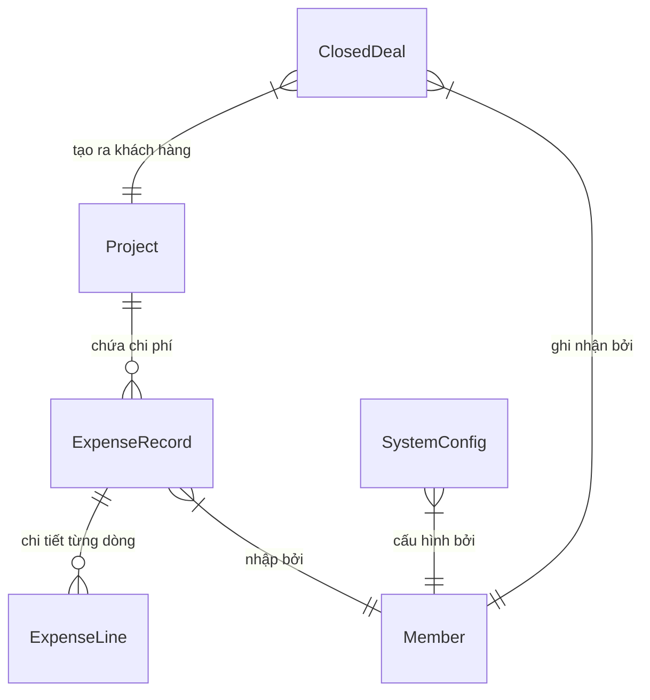

# Hướng dẫn & Đặc tả chi tiết: Module 4 - Quản lý Chi phí (Expense Management)

Chào mừng bạn đến với tài liệu hướng dẫn và đặc tả kỹ thuật chi tiết dành cho lập trình viên phát triển **Module 4 - Quản lý Chi phí (Expense Management)** thuộc hệ thống Marketing Hub (Mkt Hub) Backend. Tài liệu này cung cấp các mô tả sâu sắc về mặt nghiệp vụ tài chính, cấu trúc dữ liệu, thuật toán tính toán và đặc tả chi tiết của từng API trong hệ thống.

---

## 💡 1. Bối cảnh nghiệp vụ của Module Chi phí (Business Context)

Module Chi phí là thành phần cốt lõi giúp Ban Giám đốc (BOD) và các Quản lý (Managers) kiểm soát và đo lường chính xác hiệu quả tài chính của các hoạt động Marketing. Module này giải quyết các nghiệp vụ sau:

1. **Phân bổ Chi phí (Cost Allocation):**
   - **Chi phí Trực tiếp (Direct Cost):** Gắn liền trực tiếp với dự án hoặc chiến dịch cụ thể (ví dụ: Ngân sách quảng cáo Facebook/Google Ads, chi phí thuê Agency, in ấn vật phẩm, v.v.).
   - **Chi phí Gián tiếp (Overhead Cost):** Chi phí cố định hoặc chi phí hoạt động chung được phân bổ cho dự án (ví dụ: lương nhân sự tính theo manday, chi phí công cụ dùng chung như Canva/Zoom, chi phí văn phòng phân bổ).
2. **Chi phí sở hữu khách hàng - CAC (Customer Acquisition Cost):** Chi phí trung bình để chuyển đổi thành công một khách hàng mới trong chu kỳ cụ thể.
3. **Giá trị trọn đời khách hàng - LTV (Lifetime Value):** Ước tính doanh thu ròng mà một khách hàng mang lại trong suốt thời gian họ đồng hành cùng doanh nghiệp.
4. **Đánh giá Sức khỏe Tài chính (LTV:CAC Health):** Dựa vào tỉ số giữa LTV và CAC để đánh giá mô hình kinh doanh hoặc hiệu quả chiến dịch đang ở mức độ nào nhằm đưa ra quyết định tăng/giảm ngân sách hoặc tối ưu hóa hoạt động.

---

## 🗄️ 2. Sơ đồ dữ liệu & Mối quan hệ liên quan (Database Schema Relationships)

Mối quan hệ dữ liệu của Module Chi phí được thể hiện qua sơ đồ dưới đây:



### Chi tiết các thực thể dữ liệu trong cơ sở dữ liệu (`schema.prisma`):

#### 1. Thực thể `ExpenseRecord`
Lưu trữ thông tin tổng hợp chi phí phát sinh theo từng tháng của dự án:
* `id` *(String, UUID, @id)*: Khóa chính.
* `projectId` *(String)*: Liên kết tới bảng [Project](file:///d:/mkt-hub-backend/BE/prisma/schema.prisma).
* `month` *(Int)*: Tháng phát sinh chi phí (từ 1 đến 12).
* `year` *(Int)*: Năm phát sinh chi phí.
* `directCost` *(Decimal, default 0)*: Số tiền chi phí trực tiếp (được tự động đồng bộ từ tổng các dòng chi tiết `ExpenseLine` nếu có).
* `directNotes` *(String, optional)*: Ghi chú chi phí trực tiếp.
* `overheadCost` *(Decimal, default 0)*: Số tiền chi phí gián tiếp phân bổ.
* `overheadNotes` *(String, optional)*: Ghi chú chi phí gián tiếp.
* `createdById` *(String)*: ID của thành viên tạo bản ghi.
* `archivedAt` *(DateTime, optional)*: Thời điểm xóa mềm.
* `lines` *(ExpenseLine[])*: Danh sách các dòng chi tiết chi phí trực tiếp.
* Ràng buộc index: `@@index([projectId, month, year, archivedAt])`.

#### 2. Thực thể `ExpenseLine` (Chi tiết dòng chi phí)
Lưu trữ từng khoản mục chi phí trực tiếp trong kỳ:
* `id` *(String, UUID, @id)*: Khóa chính.
* `expenseId` *(String)*: Liên kết tới bản ghi `ExpenseRecord` cha.
* `name` *(String)*: Tên khoản chi (ví dụ: "Thuê hội trường", "Chạy Ads Meta").
* `plannedAmount` *(Decimal, default 0)*: Số tiền dự toán kế hoạch.
* `actualUnitPrice` *(Decimal, default 0)*: Đơn giá thực tế một đơn vị.
* `quantity` *(Int, default 1)*: Số lượng.
* `note` *(String, optional)*: Ghi chú chi tiết cho dòng.
* `sortOrder` *(Int, default 0)*: Thứ tự sắp xếp hiển thị trên bảng.
* `attachmentPath` *(String, optional)*: Đường dẫn lưu trữ file vật lý trên server (`uploads/expenses/...`).
* `attachmentName` *(String, optional)*: Tên file gốc người dùng tải lên.
* `attachmentMime` *(String, optional)*: Định dạng MIME của file.
* `attachmentUrl` *(String, optional)*: Đường dẫn URL tuyệt đối phục vụ xem/tải trực tiếp file.
* `archivedAt` *(DateTime, optional)*: Thời điểm xóa mềm.

#### 3. Thực thể `SystemConfig`
Lưu cấu hình hệ thống biến thiên theo thời gian phục vụ tính chỉ số LTV:
* `id` *(String, UUID, @id)*: Khóa chính.
* `key` *(String)*: Tên cấu hình (chỉ chấp nhận `'churn_rate'` hoặc `'gross_margin'`).
* `periodType` *(String)*: Loại chu kỳ áp dụng (`'month'`, `'quarter'`, `'year'`).
* `year` *(Int)*: Năm áp dụng.
* `periodValue` *(Int, optional)*: Giá trị chu kỳ cụ thể (Ví dụ: tháng `6`, hoặc quý `2`).
* `value` *(Decimal)*: Giá trị phần trăm của cấu hình (Ví dụ: `2.5` biểu thị cho 2.5%).
* `effectiveFrom` *(DateTime)*: Ngày bắt đầu có hiệu lực của cấu hình.
* `notes` *(String, optional)*: Lý do điều chỉnh cấu hình.
* `createdById` *(String)*: Người tạo cấu hình.

---

## 🛠️ 3. Chi tiết các thuật toán & Logic tính toán trong Expense Service

Mã nguồn Logic nghiệp vụ nằm hoàn toàn trong [expense.service.ts](file:///d:/mkt-hub-backend/BE/src/modules/expense/expense.service.ts).

### A. Thuật toán tìm cấu hình hệ thống có hiệu lực (`getEffectiveConfig`)
Để tính LTV tại một thời điểm lịch sử chính xác mà không bị ảnh hưởng bởi những thay đổi cấu hình hiện tại:
* **Hàm xử lý:** [getEffectiveConfig trong expense.service.ts](file:///d:/mkt-hub-backend/BE/src/modules/expense/expense.service.ts#L37-L75).
* **Các bước logic:**
  1. Quy đổi chu kỳ lọc sang ngày bắt đầu của chu kỳ (`startDate`) thông qua hàm `getPeriodDates()`.
  2. Truy vấn tìm cấu hình có trùng khớp trực tiếp thông số (`key`, `year`, `periodType`, `periodValue`).
  3. Nếu không tìm thấy khớp trực tiếp, thực hiện truy vấn tìm cấu hình có ngày hiệu lực (`effectiveFrom`) nhỏ hơn hoặc bằng ngày bắt đầu chu kỳ lọc (`lte: startDate`), sắp xếp theo `effectiveFrom` giảm dần để lấy giá trị mới nhất áp dụng trước thời điểm đó.
  4. Nếu không tồn tại bất kỳ bản ghi nào trong database, trả về giá trị mặc định hệ thống:
     - `churn_rate` = `2.0` (tương đương 2.0%)
     - `gross_margin` = `60.0` (tương đương 60.0%)

### B. Công thức tính ROA, ROAS & LTV
* **ROA (Return on Ad Spend / Doanh thu trên Chi phí):**
  $$\text{ROA} = \frac{\text{Won Value (Doanh thu}}}{\text{Total Expense (Tổng chi phí)}}$$
  - Backend trả về `roa`, `roas`, `numerator` (Doanh thu), `denominator` (Chi phí) và xử lý an toàn mẫu số 0/null.
* **Retention Months** (Thời gian gắn bó trung bình của khách hàng tính bằng tháng):
  $$\text{Retention Months} = \frac{1}{\text{Churn Rate} / 100}$$
  Ví dụ: `Churn Rate` = `2%` / tháng $\rightarrow$ `Retention Months` = $1 / 0.02 = 50$ tháng.
* **LTV (Lifetime Value):**
  $$\text{LTV} = \left( \text{Setup Fee TB} + \text{Monthly Fee TB} \times \text{Retention Months} \right) \times \left( \frac{\text{Gross Margin}}{100} \right)$$
  - *Setup Fee TB:* Trung bình phí thiết lập ban đầu của các Closed Deals trong kỳ.
  - *Monthly Fee TB:* Trung bình phí duy trì hàng tháng của các Closed Deals trong kỳ.
  - *Gross Margin:* Biên lợi nhuận gộp cấu hình.

### C. Đồng bộ Ngân sách Dự án từ Budget Marketing (Single Source of Truth)
* **Quy tắc:** Tổng ngân sách của từng dự án (`budgetTotal`) được đồng bộ trực tiếp từ cây danh mục ngân sách `BudgetValue` (phần Nhập chi phí tổng hạng mục - Budget Marketing) theo `projectId`, `year` và các tháng trong kỳ lọc.
* Tránh duy trì 2 nguồn dữ liệu độc lập gây lệch số giữa Quản lý chi phí và Ngân sách Marketing.

### D. Liên kết Dòng chi phí với Kho & Tự động Trừ kho (BE-08, BE-09, BE-10, BE-INV-001)
* **Validate & Transaction nguyên tử (BE-INV-001):**
  * Khi tạo lô hàng (`POST /v1/inventory/items/:id/batches`) hoặc tạo phiếu nhập kho (`POST /v1/inventory/entries`), hệ thống bắt buộc kiểm tra `quantity > 0`.
  * Toàn bộ thao tác tạo batch, lưu transaction kho và re-tính tồn kho được bọc trong một Prisma Transaction duy nhất (`$transaction`). Nếu có lỗi bất kỳ, toàn bộ lô cha và con sẽ được rollback hoàn toàn.
* **Quản lý Thuế VAT trong Kho (BE-08):**
  * Khi tạo lô hàng (`InventoryBatch`) hoặc phiếu nhập (`InventoryEntry`), người dùng nhập đơn giá trước thuế (`unitPriceBeforeVat`) và thuế suất (`vatRate` %).
  * Hệ thống tự động tính đơn giá sau thuế:
    $$\text{unitPriceAfterVat} = \text{round}\left(\text{unitPriceBeforeVat} \times \left(1 + \frac{\text{vatRate}}{100}\right)\right)$$
* **Tự động trừ/hoàn kho khi tạo/xóa dòng chi phí (BE-09):**
  * Khi tạo dòng chi phí liên kết với một vật phẩm kho (`inventoryItemId`):
    * Hệ thống kiểm tra số lượng tồn kho khả dụng (`totalStock >= actualQuantity`).
    * Thực hiện xuất kho theo thứ tự FIFO trên các lô hàng còn tồn trong transaction nguyên tử (`$transaction`).
    * Ghi nhận giao dịch xuất kho `InventoryTransaction` loại `'out'`.
    * Tự động lưu snapshot giá trước/sau VAT (`unitPriceBeforeVatSnapshot`, `vatRateSnapshot`, `unitPriceAfterVatSnapshot`) để bảo vệ dữ liệu lịch sử khi giá kho thay đổi trong tương lai.
  * Khi cập nhật/xóa dòng chi phí: Hệ thống hoàn trả hoặc điều chỉnh tồn kho tự động trong `$transaction`.
* **Hỗ trợ Danh mục Tự do "Khác" & "Thêm hạng mục" (`__custom__` / `__other__`):**
  * Với các khoản chi không lấy từ kho (`isCustom = true`, `categoryId = '__custom__'` hoặc `categoryId = '__other__'`), người dùng có thể nhập trực tiếp mô tả, đơn giá, % VAT, số lượng kế hoạch và số lượng thực tế tự do.
  * Backend không bắt buộc `inventoryItemId`, lưu giữ đúng số lượng người dùng nhập (không ép về 1), và tính toán đầy đủ vào tổng chi phí dự án / kỳ báo cáo.

### E. Báo cáo Chi phí & Lịch sử Chi phí (BE-11, BE-COST-003)
* **Tính toán Ngân sách & Thực tế:**
  * `budgetTotal` được đồng bộ từ Marketing Budget hoặc dự toán `SUM(plannedAmount)` của các dòng chi phí.
  * `actualTotal` được tính từ tổng chi phí thực tế `SUM(actualAmount)`.
  * Bổ sung các chỉ số phân tách trước thuế và sau thuế: `plannedTotalBeforeVat`, `plannedTotalAfterVat`, `actualTotalBeforeVat`, `actualTotalAfterVat`.
* **Lịch sử Chi phí Kế hoạch (BE-COST-003):**
  * `formatLine` và `formatExpense` luôn trả về đúng `plannedAmount` và `plannedCost` dựa trên snapshot đơn giá sau thuế hoặc fallback `plannedQuantity * unitPriceAfterVatSnapshot`, không trả về 0 sai lệch.
* **Phân quyền Manager-only:**
  * Các endpoint `GET /v1/expenses/overview` và `GET /v1/expenses/report` được bảo vệ bằng `@Roles(Role.manager)`. Tài khoản Specialist khi truy cập sẽ bị từ chối với mã lỗi `403 Forbidden`.

---

## 🚀 4. Đặc tả kỹ thuật chi tiết các API Endpoints

Mã nguồn Controller: [expense.controller.ts](file:///d:/mkt-hub-backend/BE/src/modules/expense/expense.controller.ts).
Các Guard áp dụng: `JwtAuthGuard` (xác thực token) và `RolesGuard` (phân quyền vai trò).

### API 1: Lưu (Tạo mới hoặc Cập nhật) Chi phí của Dự án
* **Endpoint:** `POST /v1/expenses`
* **Quyền hạn:** Manager
* **File xử lý:** `saveExpense()` tại [expense.controller.ts:Line 27-33](file:///d:/mkt-hub-backend/BE/src/modules/expense/expense.controller.ts#L27-L33) kết nối [expense.service.ts:Line 122-191](file:///d:/mkt-hub-backend/BE/src/modules/expense/expense.service.ts#L122-L191).
* **Input (Body - `SaveExpenseRecordDto`):**
  ```json
  {
    "projectId": "8e3c79a4-2e92-4fdb-85d9-366a3d1dfcfc",
    "month": 6,
    "year": 2026,
    "directCost": 50000000,
    "directNotes": "Facebook Ads: 30M, In brochure: 20M",
    "overheadCost": 20000000,
    "overheadNotes": "Nhân sự 2 người: 20M"
  }
  ```
* **Ràng buộc nghiệp vụ:**
  - Kiểm tra dự án có tồn tại không. Nếu không, ném ra lỗi `NotFoundException`.
  - Dự án không được có trạng thái là `Cancelled`. Nếu có, ném ra lỗi `BadRequestException`.
  - Nếu đã tồn tại bản ghi chi phí cùng dự án, tháng, năm $\rightarrow$ thực hiện `update` (tự động reset `archivedAt: null` và `archivedBy: null` để khôi phục bản ghi nếu trước đó bị xóa mềm). Ngược lại, thực hiện `create`.
  - Toàn bộ hành động đều được ghi log chi tiết vào bảng `AuditLog` thông qua `AuditService`.
* **Output:** Bản ghi `ExpenseRecord` chi tiết.

### API 2: Lấy danh sách Chi phí Dự án
* **Endpoint:** `GET /v1/expenses`
* **Quyền hạn:** Manager, Specialist
* **File xử lý:** `getExpenses()` tại [expense.controller.ts](file:///d:/mkt-hub-backend/BE/src/modules/expense/expense.controller.ts) kết nối [expense.service.ts](file:///d:/mkt-hub-backend/BE/src/modules/expense/expense.service.ts).
* **Input (Query Params):**
  - `projectId` *(string, optional)*
  - `month` *(string, optional)*
  - `year` *(string, optional)*
* **Output:** Danh sách các bản ghi chi phí (đã lọc `archivedAt: null`), kèm chi tiết mảng `lines[]`:
  ```json
  [
    {
      "id": "exp-uuid-1",
      "projectId": "project-uuid-1",
      "month": 6,
      "year": 2026,
      "directCost": 50000000,
      "directNotes": "Chi phí tổ chức sự kiện",
      "overheadCost": 20000000,
      "overheadNotes": "Nhân sự...",
      "lines": [
        {
          "id": "line-uuid-1",
          "expenseId": "exp-uuid-1",
          "name": "Thuê hội trường",
          "plannedAmount": 30000000,
          "actualUnitPrice": 28000000,
          "quantity": 1,
          "totalAmount": 28000000,
          "note": "Tầng 3 khách sạn",
          "sortOrder": 0,
          "attachmentName": "hop_dong_thue.pdf",
          "attachmentUrl": "https://mkt-hub-be.onrender.com/api/v1/expenses/lines/line-uuid-1/attachment",
          "url": "https://mkt-hub-be.onrender.com/api/v1/expenses/lines/line-uuid-1/attachment",
          "createdAt": "2026-08-23T10:00:00.000Z"
        }
      ],
      "project": {
        "name": "Campaign Launching 2026",
        "type": "Online Campaign",
        "status": "Active",
        "budgetPlanDirect": "60000000",
        "budgetPlanOverhead": "25000000"
      }
    }
  ]
  ```

### API 3: Xóa bản ghi Chi phí Dự án (Soft Delete)
* **Endpoint:** `DELETE /v1/expenses/:id`
* **Quyền hạn:** Manager
* **File xử lý:** `removeExpense()` tại [expense.controller.ts](file:///d:/mkt-hub-backend/BE/src/modules/expense/expense.controller.ts) kết nối [expense.service.ts](file:///d:/mkt-hub-backend/BE/src/modules/expense/expense.service.ts).
* **Output:** `{ "success": true }`. Hành động xóa mềm được ghi nhận vào `AuditLog`.

---

### PHÂN NHÓM: QUẢN LÝ DÒNG CHI PHÍ & FILE HỢP ĐỒNG / HÓA ĐƠN (EXPENSE LINES)

#### API 8: Thêm dòng chi phí mới vào bản ghi chi phí
* **Endpoint:** `POST /v1/expenses/:id/lines`
* **Quyền hạn:** Manager
* **Input (Param):** `id` *(string, UUID, required)* - ID bản ghi chi phí cha.
* **Input (Body - `CreateExpenseLineDto`):**
  ```json
  {
    "name": "Thuê địa điểm tổ chức",
    "plannedAmount": 30000000,
    "actualUnitPrice": 28000000,
    "quantity": 1,
    "note": "Hội trường A",
    "sortOrder": 0
  }
  ```
* **Logic nghiệp vụ:** Tạo dòng chi phí và tự động cập nhật lại tổng `directCost = Σ(actualUnitPrice × quantity)` của bản ghi chi phí cha.
* **Output:** Đối tượng `ExpenseLineDto` vừa tạo.

#### API 9: Cập nhật dòng chi phí
* **Endpoint:** `PATCH /v1/expenses/lines/:id`
* **Quyền hạn:** Manager
* **Input (Param):** `id` *(string, UUID, required)* - ID của dòng chi phí.
* **Input (Body - `UpdateExpenseLineDto`):**
  ```json
  {
    "actualUnitPrice": 29000000,
    "quantity": 1
  }
  ```
* **Logic nghiệp vụ:** Cập nhật thông tin dòng và tự động tính lại `directCost` của bản ghi cha.
* **Output:** Đối tượng `ExpenseLineDto` sau khi cập nhật.

#### API 10: Xóa mềm dòng chi phí
* **Endpoint:** `DELETE /v1/expenses/lines/:id`
* **Quyền hạn:** Manager
* **Logic nghiệp vụ:** Đánh dấu `archivedAt = new Date()`, tự động tính lại `directCost` của bản ghi cha.
* **Output:** `{ "success": true, "message": "Đã xóa dòng chi phí thành công." }`

#### API 11: Tải lên file hợp đồng / hóa đơn cho dòng chi phí
* **Endpoint:** `POST /v1/expenses/lines/:id/attachments`
* **Quyền hạn:** Manager
* **Content-Type:** `multipart/form-data` (trường `file`)
* **Logic nghiệp vụ:** Lưu file vào `uploads/expenses/`, cập nhật metadata và sinh `attachmentUrl` (URL tuyệt đối).
* **Output:** Đối tượng `ExpenseLineDto` kèm đường dẫn `attachmentUrl` và `url`.

#### API 12: Xem hoặc tải file hợp đồng / hóa đơn của dòng chi phí (Streaming inline)
* **Endpoint:** `GET /v1/expenses/lines/:id/attachment`
* **Mục đích:** Cho phép xem trực tiếp file PDF / ảnh trên tab trình duyệt hoặc tải về.
* **Cơ chế:**
  - Header: `Content-Disposition: inline; filename="..."`
  - Trả về mã lỗi `404 Not Found` nếu dòng chi phí hoặc bản ghi chi phí cha đã bị xóa mềm (`archivedAt != null`).

---

### API 4: Cấu hình tham số hệ thống (Churn Rate & Gross Margin)
* **Endpoint:** `POST /v1/expenses/system-configs`
* **Quyền hạn:** Manager
* **File xử lý:** `saveSystemConfig()` tại [expense.controller.ts:Line 57-63](file:///d:/mkt-hub-backend/BE/src/modules/expense/expense.controller.ts#L57-V63) kết nối [expense.service.ts:Line 78-106](file:///d:/mkt-hub-backend/BE/src/modules/expense/expense.service.ts#L78-L106).
* **Input (Body - `SaveSystemConfigDto`):**
  ```json
  {
    "key": "churn_rate",
    "periodType": "month",
    "year": 2026,
    "periodValue": 6,
    "value": 2.5,
    "effectiveFrom": "2026-06-01T00:00:00.000Z",
    "notes": "Điều chỉnh theo tỷ lệ rời bỏ thực tế Q2"
  }
  ```
* **Output:** Bản ghi `SystemConfig` vừa tạo.

### API 5: Lấy Lịch sử Thay đổi Cấu hình
* **Endpoint:** `GET /v1/expenses/system-configs`
* **Quyền hạn:** Manager, Specialist
* **Input (Query Params):** `key` *(string, optional, enum: churn_rate, gross_margin)*
* **File xử lý:** `getSystemConfigHistory()` tại [expense.controller.ts:Line 65-69](file:///d:/mkt-hub-backend/BE/src/modules/expense/expense.controller.ts#L65-L69) kết nối [expense.service.ts:Line 108-120](file:///d:/mkt-hub-backend/BE/src/modules/expense/expense.service.ts#L108-L120).

### API 6: Lấy dữ liệu Tổng quan (Overview Tab)
* **Endpoint:** `GET /v1/expenses/overview`
* **Quyền hạn:** Manager, Specialist
* **File xử lý:** `getOverview()` tại [expense.controller.ts](file:///d:/mkt-hub-backend/BE/src/modules/expense/expense.controller.ts) kết nối [expense.service.ts](file:///d:/mkt-hub-backend/BE/src/modules/expense/expense.service.ts).
* **Input (Query Params):** `period` *(string, required)* - Định dạng: `YYYY`, `YYYY-MM` hoặc `YYYY-QX`.
* **Output:** Dữ liệu tổng hợp phục vụ hiển thị KPI Cards và danh sách so sánh Budget vs Actual chi phí của từng dự án:
  ```json
  {
    "period": "2026",
    "metrics": {
      "totalExpense": 367335735,
      "wonCount": 8,
      "wonValue": 2611000000,
      "roas": 7.1,
      "cac": 45916967,
      "totalWonValue": 2611000000,
      "ltv": 159000000,
      "ltvCacRatio": 3.46,
      "ratio": 3.5,
      "newCustomers": 8,
      "health": {
        "status": "Tỷ lệ vàng",
        "color": "🟢 Xanh lá",
        "visual": "green"
      }
    },
    "projects": [
      {
        "projectId": "project-uuid-1",
        "projectName": "Campaign Q2",
        "projectType": "Online Campaign",
        "budgetTotal": 100000000,
        "actualTotal": 87000000,
        "variance": 13000000,
        "newCustomers": 12,
        "projectCac": 7250000
      }
    ]
  }
  ```

#### 📌 Quy tắc nghiệp vụ và công thức tính toán (Mục 8):
* **`wonCount` (number):** Số lượng Closed Deal có `closedDate` nằm trong kỳ (`archivedAt: null`).
* **`wonValue` (number):** Tổng giá trị deal cùng kỳ tính theo `setupFee` (đồng nhất với actual của card Won trên dashboard).
* **`roas` (number | null):** $\text{ROAS} = \frac{\text{wonValue}}{\text{totalExpense}}$; trả về `null` nếu `totalExpense <= 0` hoặc `wonCount === 0`.
* **`cac` (number | null):** $\text{CAC} = \frac{\text{totalExpense}}{\text{wonCount}}$; trả về `null` nếu `wonCount === 0`.

### API 7: Lấy dữ liệu Báo cáo Phân tích (Report Tab)
* **Endpoint:** `GET /v1/expenses/report`
* **Quyền hạn:** Manager, Specialist
* **File xử lý:** `getReports()` tại [expense.controller.ts:Line 77-81](file:///d:/mkt-hub-backend/BE/src/modules/expense/expense.controller.ts#L77-L81) kết nối [expense.service.ts:Line 434-511](file:///d:/mkt-hub-backend/BE/src/modules/expense/expense.service.ts#L434-511).
* **Input (Query Params):** `period` *(string, required)*
* **Output:**
  - `costByType`: Thống kê chi phí gom theo loại dự án (Project Type) phục vụ vẽ Donut Chart.
  - `monthlyTrend`: Xu hướng chi phí tổng hợp qua các tháng trong năm phục vụ vẽ Line Chart (2 trục Y: Tổng chi phí và CAC).
  - `projectComparison`: Mảng so sánh kế hoạch chi phí (Budget) vs Thực tế (Actual) của từng dự án phục vụ vẽ Bar Chart.
  - `detailedTable`: Danh sách chi tiết hỗ trợ lọc và sắp xếp trên UI.

---

## 📊 4. Đặc tả API Phân hệ Ngân sách (Budget Management)

Phân hệ Ngân sách hỗ trợ thiết lập cây hạng mục đa cấp, nhập và tổng hợp số liệu kế hoạch theo 12 tháng, tính toán tỷ trọng phân bổ và cung cấp số liệu Dashboard so sánh giữa Ngân sách và Thực chi.

### API 8: Lấy Bảng Tổng Hợp Ngân Sách 12 Tháng (Summary Table)
* **Endpoint:** `GET /api/budgets/summary`
* **Quyền hạn:** Manager, Specialist, Admin
* **File xử lý:** `getSummary()` tại [budgets.controller.ts](file:///d:/mkt-hub-backend/BE/src/modules/expense/budgets.controller.ts) kết nối [category-budget.service.ts](file:///d:/mkt-hub-backend/BE/src/modules/expense/category-budget.service.ts).
* **Input (Query Params):**
  - `projectId` *(string, optional, default: "all")*: ID dự án hoặc `"all"` để lấy toàn bộ dự án trong phạm vi quyền.
  - `year` *(number, optional, default: 2026)*: Năm tài chính/báo cáo.
* **Quy tắc tính toán:**
  - `months`: Mảng 12 giá trị số nguyên VND tương ứng tháng 1..12. Giá trị của hạng mục cha (dòng màu xanh) bằng tổng của chính nó và tất cả nhóm con thuộc nó trong tháng tương ứng.
  - `yearTotal`: Tổng cộng của 12 tháng.
  - `totalBudget`: Tổng ngân sách của tất cả các hạng mục cấp cao nhất (`parentId = null`).
  - `percentage`: Tỷ trọng ngân sách của hạng mục so với `totalBudget` (`percentage = yearTotal / totalBudget * 100`, làm tròn 2 chữ số thập phân; trả về `0` nếu `totalBudget = 0`).
* **Output:**
  ```json
  {
    "projectId": "all",
    "year": 2026,
    "totalBudget": 110000000,
    "categories": [
      {
        "id": "cat-branding",
        "name": "Branding Marketing",
        "parentId": null,
        "months": [5000000, 5000000, 5000000, 5000000, 5000000, 5000000, 5000000, 5000000, 5000000, 5000000, 5000000, 5500000],
        "yearTotal": 60500000,
        "percentage": 55.0,
        "children": [
          {
            "id": "sub-brand-online",
            "name": "Brand Online",
            "parentId": "cat-branding",
            "months": [5000000, 5000000, 5000000, 5000000, 5000000, 5000000, 5000000, 5000000, 5000000, 5000000, 5000000, 5500000],
            "yearTotal": 60500000,
            "percentage": 55.0,
            "children": []
          }
        ]
      }
    ]
  }
  ```

### API 9: Lưu / Cập Nhật Ngân Sách Theo Dự Án & Năm
* **Endpoint:** `PUT /api/budgets/:projectId/:year`
* **Quyền hạn:** Manager, Specialist, Admin
* **File xử lý:** `saveBudget()` tại [budgets.controller.ts](file:///d:/mkt-hub-backend/BE/src/modules/expense/budgets.controller.ts) kết nối [category-budget.service.ts](file:///d:/mkt-hub-backend/BE/src/modules/expense/category-budget.service.ts).
* **Input (Path & Body):**
  - Path Params: `projectId` *(string)*, `year` *(number)*.
  - Body:
    ```json
    {
      "items": [
        { "categoryId": "item-uuid-1", "month": 1, "amount": 5000000 },
        { "categoryId": "item-uuid-1", "month": 2, "amount": 5000000 }
      ]
    }
    ```
* **Ràng buộc nghiệp vụ:**
  - Thực hiện trong Prisma transaction.
  - `amount >= 0`, `month` từ 1..12.
  - Tự động kiểm tra quyền và xác thực sự tồn tại của dự án và hạng mục.
  - Tự động ghi Audit Log truy vết.

### API 10: Lấy Dữ Liệu Dashboard Ngân Sách
* **Endpoint:** `GET /v1/expense-budgets/dashboard`
* **Quyền hạn:** Manager, Specialist, Admin
* **File xử lý:** `getDashboard()` tại [category-budget.controller.ts](file:///d:/mkt-hub-backend/BE/src/modules/expense/category-budget.controller.ts) kết nối [category-budget.service.ts](file:///d:/mkt-hub-backend/BE/src/modules/expense/category-budget.service.ts).
* **Input (Query Params):**
  - `projectId` *(string, optional, default: "all")*: ID dự án hoặc `"all"`.
  - `year` *(number, optional, default: 2026)*: Năm báo cáo.
* **Quy tắc tính toán:**
  - `totalBudget`: Tổng ngân sách kế hoạch trong năm.
  - `actualSpent`: Tổng chi phí thực tế đã chi trong năm (từ `ExpenseRecord` + `ExpenseLine` không bị soft-delete).
  - `remainingBudget`: $\text{remainingBudget} = \text{totalBudget} - \text{actualSpent}$ (trả về số âm nếu thực chi vượt ngân sách).
  - `usedPercentage`: $\text{usedPercentage} = \frac{\text{actualSpent}}{\text{totalBudget}} \times 100$ (trả về `null` nếu `totalBudget = 0`).

### API 11: Báo Cáo Tổng Hợp Kế Hoạch vs Thực Tế Theo Hạng Mục (Dynamic Category Budget Report)
* **Endpoint:** `GET /v1/expense-budgets/report`
* **Quyền hạn:** Manager, Specialist, Admin
* **File xử lý:** `getCategoryReport()` tại [category-budget.controller.ts](file:///d:/mkt-hub-backend/BE/src/modules/expense/category-budget.controller.ts) kết nối [category-budget.service.ts](file:///d:/mkt-hub-backend/BE/src/modules/expense/category-budget.service.ts).
* **Input (Query Params):**
  - `year` *(number, optional, default: 2026)*: Năm báo cáo.
  - `month` *(number, optional)*: Tháng lọc (1..12).
  - `projectId` *(string, optional)*: Lọc theo dự án cụ thể hoặc `"all"`.
* **Quy tắc nghiệp vụ cốt lõi:**
  - **Kế hoạch (Plan):** Lấy từ cấu hình `BudgetValue` theo Category/Năm/Tháng.
  - **Thực tế (Actual):** Tính động bằng $\sum \text{ExpenseLine.actualAmount}$ thuộc Category trong kỳ lọc. **Không cho phép nhập tay Actual Category.**
  - **Còn lại (Remaining):** $\text{Remaining} = \text{Plan} - \text{Actual}$.
  - **Tỷ lệ sử dụng (Usage %):** $\text{Usage \%} = \frac{\text{Actual}}{\text{Plan}} \times 100$ (trả về `null` nếu `Plan = 0`).
* **Output:**
  ```json
  {
    "data": {
      "year": 2026,
      "month": 9,
      "projectId": "all",
      "totalPlan": 1500000000,
      "totalActual": 1120000000,
      "totalRemaining": 380000000,
      "totalUsagePercent": 74.67,
      "categories": [
        {
          "categoryId": "cat-branding",
          "categoryName": "Branding Marketing",
          "plan": 700000000,
          "actual": 500000000,
          "remaining": 200000000,
          "usagePercent": 71.43
        },
        {
          "categoryId": "cat-digital",
          "categoryName": "Digital Marketing",
          "plan": 800000000,
          "actual": 620000000,
          "remaining": 180000000,
          "usagePercent": 77.5
        }
      ]
    },
    "permissions": {
      "view": true,
      "edit": true,
      "manageCategories": true,
      "export": true
    }
  }
  ```

---

## 💡 5. Một số lưu ý quan trọng khi phát triển tiếp (Developer Tips)

1. **Xử lý số thập phân (Decimal):** Toàn bộ các trường chi phí, doanh thu, tỉ lệ đều được lưu dưới dạng `Decimal` trong cơ sở dữ liệu để tránh sai lệch làm tròn dấu phẩy động. Khi tính toán trong service, hãy ép kiểu về `Number()` cẩn thiện và thực hiện phép cộng dồn với `reduce`.
2. **Quản lý Tồn kho theo Delta chênh lệch:**
   - Khi `UPDATE` số lượng dòng chi phí vật phẩm kho: luôn tính `delta = new_actual_qty - old_actual_qty` và kiểm tra tồn kho trước khi trừ.
   - Tuyệt đối không dùng `stock -= new_actual_qty` trực tiếp để tránh cộng dồn sai lệch kho.
3. **Tính nhất quán Transaction:** Toàn bộ thao tác cập nhật chi phí và biến động kho phải được bọc trong `prisma.$transaction`.


