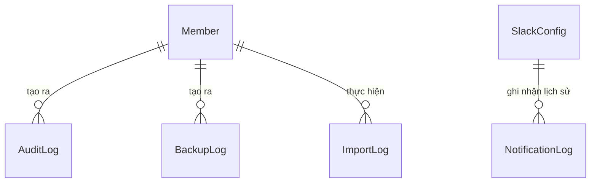

# Hướng dẫn & Đặc tả chi tiết: Module 5 - Quản trị Hệ thống & Nhập xuất Dữ liệu (Data Management)

Chào mừng bạn đến với tài liệu hướng dẫn và đặc tả kỹ thuật chi tiết dành cho lập trình viên phát triển **Module 5 - Quản trị Hệ thống & Nhập xuất Dữ liệu (Data Management)** thuộc hệ thống Marketing Hub (Mkt Hub) Backend. Tài liệu này cung cấp các mô tả sâu sắc về mặt nghiệp vụ quản trị, luồng dữ liệu, tích hợp hệ thống bên thứ ba và đặc tả chi tiết của từng API trong hệ thống.

---

## 💡 1. Bối cảnh nghiệp vụ của Module Data Management (Business Context)

Module Data Management là "bộ máy vận hành" đằng sau hệ thống Mkt Hub, cho phép Manager và Specialist duy trì và bảo trì hệ thống hiệu quả qua các bài toán chính sau:

1. **Nhập/Xuất dữ liệu hàng loạt (Import/Export):**
   - **Import:** Tiết kiệm thời gian bằng cách tải lên file Excel/CSV (nhập danh sách Task, KPI lịch sử, Closed Deal lịch sử).
   - **Export:** Xuất báo cáo PDF/Excel chất lượng cao cho Ban giám đốc (BOD), đối tác và kiểm toán.
2. **Quản lý thành viên (Team Members):** Quản lý tài khoản nhân viên, cấp quyền (`manager` / `specialist`) và đảm bảo an toàn truy cập.
3. **Cấu hình động (Dropdown Config):** Giúp Manager tự cấu hình các tùy chọn dropdown hệ thống (như loại dự án, trạng thái dự án, độ ưu tiên công việc) mà không cần can thiệp vào mã nguồn.
4. **Tích hợp Slack Notification:** Tự động hóa gửi tin nhắn cảnh báo công việc quá hạn hoặc sắp đến hạn vào kênh Slack của nhóm Marketing hằng ngày.
5. **Sao lưu & Đảm bảo an toàn (Backup & Reset):** Sao lưu toàn bộ database định kỳ, hỗ trợ khôi phục (Restore) khi có sự cố và cơ chế đặt lại (Reset Sandbox) dữ liệu thử nghiệm của dự án.

---

## 🗄️ 2. Sơ đồ dữ liệu & Mối quan hệ liên quan (Database Schema Relationships)

Mối quan hệ dữ liệu của Module Quản trị Hệ thống được thể hiện qua sơ đồ dưới đây:



### Chi tiết các thực thể dữ liệu trong cơ sở dữ liệu (`schema.prisma`):

#### 1. Thực thể `Member`
Lưu trữ thông tin tài khoản người dùng:
* `id` *(String, UUID, @id)*: Khóa chính.
* `memberId` *(Int, unique)*: ID số tự tăng của thành viên.
* `name` *(String)*: Họ và tên.
* `email` *(String, unique)*: Email đăng nhập.
* `passwordHash` *(String)*: Mật khẩu đã được mã hóa bằng bcrypt.
* `role` *(String, default "specialist")*: Quyền hạn (chỉ chấp nhận `'manager'` hoặc `'specialist'`).
* `avatarUrl` *(String, optional)*: Ký tự viết tắt của tên làm avatar (Ví dụ: "TN" cho Truc Nguyen).
* `isActive` *(Boolean, default true)*: Trạng thái tài khoản.
* Tham khảo schema: [Member trong schema.prisma](file:///d:/mkt-hub-backend/BE/prisma/schema.prisma#L11-L35).

#### 2. Thực thể `DropdownConfig` & `DropdownOption` (BE-12)
* **`DropdownConfig`**: Lưu trữ cấu hình key và danh sách mảng JSON giá trị legacy.
* **`DropdownOption`**: Lưu trữ từng tùy chọn giá trị được chuẩn hóa:
  * `id` *(String, UUID, @id)*: Khóa chính.
  * `dropdownKey` *(String)*: Khóa danh mục dropdown (Ví dụ: `'project_type'`, `'task_status'`).
  * `label` *(String)*: Tên hiển thị của tùy chọn.
  * `normalizedLabel` *(String)*: Tên chuẩn hóa chữ thường và loại bỏ khoảng trắng thừa (`label.trim().toLowerCase()`).
  * `isActive` *(Boolean, default true)*: Trạng thái hoạt động (dùng cho xóa mềm).
  * `sortOrder` *(Int, default 0)*: Thứ tự hiển thị.
  * Ràng buộc duy nhất: `@@unique([dropdownKey, normalizedLabel])` — chống tạo trùng lặp giá trị trong cùng một danh mục (không phân biệt chữ hoa/thường) mà không ảnh hưởng sang các danh mục khác.

#### 3. Thực thể `SlackConfig`
Lưu trữ cấu hình kết nối Webhook Slack:
* `id` *(String, UUID, @id)*: Khóa chính.
* `webhookUrl` *(String)*: URL Webhook của Slack.
* `channel` *(String)*: Kênh nhận thông báo (Ví dụ: `#mkt-alerts`).
* `notificationsEnabled` *(Boolean, default true)*: Cờ bật/tắt thông báo.
* `sendTime` *(String, default "08:00")*: Thời gian gửi cảnh báo hằng ngày (Định dạng "HH:MM").
* `sendDays` *(String)*: Các thứ gửi thông báo trong tuần (Ví dụ: `"T2,T3,T4,T5,T6"`).
* `alertDaysBefore` *(Int, default 5)*: Số ngày trước deadline để gửi cảnh báo sắp đến hạn.
* Tham khảo schema: [SlackConfig trong schema.prisma](file:///d:/mkt-hub-backend/BE/prisma/schema.prisma#L270-L280).

---

## 🛠️ 3. Chi tiết các quy tắc nghiệp vụ đặc trưng & Luồng xử lý

Mã nguồn nghiệp vụ nằm trong [data-management.service.ts](file:///d:/mkt-hub-backend/BE/src/modules/data-management/data-management.service.ts).

### A. Cơ chế Import Dữ Liệu Hàng Loạt 2 Bước
Nhằm đảm bảo dữ liệu nhập vào luôn sạch và tránh lỗi, quy trình Import hoạt động như sau:
1. **Bước 1 — Preview (Dry-run):**
   - Đọc tệp tin tải lên bằng thư viện `exceljs` hoặc parse CSV.
   - Kiểm tra cấu trúc cột và dữ liệu từng dòng (định dạng ngày, kiểu số, sự tồn tại của khóa ngoại như `projectId` hoặc `assignee`).
   - Phân loại: Mảng các dòng hợp lệ và mảng các dòng lỗi (kèm chi tiết số dòng và thông tin lỗi cụ thể).
   - *Không lưu vào database.*
   - Tham khảo code: [parseImportFile trong data-management.service.ts:Line 472-562](file:///d:/mkt-hub-backend/BE/src/modules/data-management/data-management.service.ts#L472-L562).
2. **Bước 2 — Confirm (Commit):**
   - FE gửi mảng các dòng hợp lệ đã xác nhận lên API.
   - Backend thực hiện chèn dữ liệu đồng loạt (Bulk Insert) trong một Transaction để đảm bảo tính toàn vẹn.
   - Ghi nhận nhật ký import vào bảng `ImportLog`.
   - Tham khảo code: [importConfirm trong data-management.service.ts:Line 564-679](file:///d:/mkt-hub-backend/BE/src/modules/data-management/data-management.service.ts#L564-L679).

### B. Tác vụ gửi thông báo Slack tự động (Cron Job / Interval)
* **Logic quét:** Cứ mỗi phút, hàm `checkAndSendSlackNotifications` được kích hoạt thông qua `setInterval`.
* **Quy trình:**
  1. Kiểm tra cấu hình Slack có bật không, hôm nay có thuộc danh sách ngày gửi (`sendDays`) không, và giờ phút hiện tại (GMT+7) có khớp với `sendTime` không.
  2. Truy vấn danh sách các Task quá hạn (`dueDate < hôm nay` và `status != Done`).
  3. Truy vấn danh sách các Task sắp đến hạn (`dueDate` nằm trong khoảng từ hôm nay đến `hôm nay + alertDaysBefore` ngày và `status != Done`).
  4. Định dạng chuỗi payload gửi tới Slack Webhook bằng Block Kit hoặc text định dạng Markdown.
  5. Ghi nhận nhật ký lượt gửi vào bảng `NotificationLog` (lưu trạng thái thành công hoặc nội dung lỗi cụ thể nếu thất bại).
* Tham khảo code: [checkAndSendSlackNotifications trong data-management.service.ts:Line 355-469](file:///d:/mkt-hub-backend/BE/src/modules/data-management/data-management.service.ts#L355-L469).

### C. Cơ chế kiểm soát Xóa mềm thành viên (Soft Delete)
- Khi Manager nhấn xóa thành viên, Backend không dùng lệnh `delete` trực tiếp nhằm tránh làm hỏng các bản ghi liên kết khóa ngoại (như Assignee của Task, người tạo Closed Deal, v.v.).
- Thay vào đó, Backend cập nhật trạng thái `isActive = false`. Người dùng bị deactivate sẽ không thể đăng nhập vào hệ thống, nhưng thông tin lịch sử của họ vẫn được bảo toàn.
- Ngăn chặn Manager tự vô hiệu hóa tài khoản hoặc hạ quyền (`role`) của chính mình.
* Tham khảo code: [updateMember:Line 101-152](file:///d:/mkt-hub-backend/BE/src/modules/data-management/data-management.service.ts#L101-L152) và [removeMember:Line 154-180 trong data-management.service.ts](file:///d:/mkt-hub-backend/BE/src/modules/data-management/data-management.service.ts#L154-L180).

### D. Backup & Khôi phục (Backup & Restore)
- **Backup:** Xuất toàn bộ cơ sở dữ liệu thành tệp tin nén `.zip` chứa file JSON của từng bảng và file Excel tổng hợp dữ liệu. Tệp tin được lưu trong thư mục `database/backups/`.
- **Restore:** Đọc tệp tin nén tải lên, xóa sạch dữ liệu Demo hiện tại trong database và chèn lại toàn bộ dữ liệu từ file backup theo đúng thứ tự ràng buộc khóa ngoại (Foreign Key).
- **Reset Sandbox:** Xóa toàn bộ dữ liệu nghiệp vụ (Project, Task, Opportunity, KPI, Expense) nhưng giữ lại cấu hình hệ thống (Members, Dropdown, Slack Config).

---

## 🚀 4. Đặc tả kỹ thuật các API Endpoints

Mã nguồn Controller: [data-management.controller.ts](file:///d:/mkt-hub-backend/BE/src/modules/data-management/data-management.controller.ts).

### PHÂN NHÓM A: QUẢN LÝ THÀNH VIÊN (TEAM MEMBERS) - Đọc (Tất cả quyền) / Ghi (Chỉ dành cho Manager)
Đường dẫn cơ sở: `/v1/data-management/members`

#### 1. Lấy danh sách thành viên
* **Endpoint:** `GET /v1/data-management/members`
* **Quyền truy cập:** Cả `manager` và `specialist` đều có quyền gọi để điền thông tin dropdown trên giao diện.
* **File xử lý:** `getMembers()` tại [data-management.service.ts:Line 33-47](file:///d:/mkt-hub-backend/BE/src/modules/data-management/data-management.service.ts#L33-L47).

#### 2. Thêm mới thành viên
* **Endpoint:** `POST /v1/data-management/members`
* **Quyền truy cập:** Chỉ `manager` mới được thực hiện.
* **Input (Body - `CreateMemberDto`):**
  ```json
  {
    "name": "Nguyen Van C",
    "email": "c.nguyen@company.com",
    "role": "specialist",
    "password": "SecurePassword123"
  }
  ```
* **Logic:** Kiểm tra email trùng lặp. Tự động mã hóa mật khẩu bằng bcrypt. Tự động sinh `avatarUrl` bằng chữ cái viết tắt của Họ và Tên (Ví dụ: "NVC").
* **Output:** Đối tượng Member sau khi tạo (đã loại bỏ `passwordHash`).

#### 3. Cập nhật thành viên
* **Endpoint:** `PUT /v1/data-management/members/:id`
* **Quyền truy cập:** Chỉ `manager` mới được thực hiện.
* **Input (Body - `UpdateMemberDto`):** Cho phép cập nhật `name`, `email`, `role`, `isActive`, `password`.
* **Ràng buộc:** Ngăn chặn Manager tự cập nhật `role` hoặc `isActive = false` của chính mình.

#### 4. Vô hiệu hóa thành viên (Xóa mềm)
* **Endpoint:** `DELETE /v1/data-management/members/:id`
* **Quyền truy cập:** Chỉ `manager` mới được thực hiện.

---

### PHÂN NHÓM B: CẤU HÌNH DROPDOWN (DROPDOWNS) - Đọc (Tất cả quyền) / Ghi (Chỉ dành cho Manager)

#### 1. Lấy danh sách cấu hình dropdown
* **Endpoint:** `GET /v1/data-management/dropdowns`
* **Quyền truy cập:** Cả `manager` và `specialist` đều có quyền gọi để hiển thị dropdown lựa chọn trên giao diện.
* **Output:** Trả về danh sách cấu hình dropdown, trong đó trường `values` đã được phân tích thành mảng JSON (`string[]`):
  ```json
  [
    {
      "id": "uuid-1",
      "key": "project_type",
      "label": "Loại Project",
      "values": ["Workshop", "Event", "Exhibition", "Webinar"]
    }
  ]
  ```

#### 2. Cập nhật giá trị dropdown
* **Endpoint:** `PUT /v1/data-management/dropdowns/:key`
* **Quyền truy cập:** Chỉ `manager` mới được thực hiện.
* **Input (Body - `UpdateDropdownDto`):** `{ "values": ["Planning", "Active", "Completed"] }`
* **Nghiệp vụ:** Nếu một giá trị đang được sử dụng ở các bản ghi khác trong database bị xóa khỏi danh sách mới, Backend sẽ kiểm tra và ném ra cảnh báo số lượng bản ghi bị ảnh hưởng để FE hiển thị xác nhận từ người dùng.

---

### PHÂN NHÓM C: TÍCH HỢP SLACK (SLACK SETTINGS) - Đọc (Tất cả quyền) / Ghi (Chỉ dành cho Manager)

#### 1. Lấy cấu hình Slack Webhook
* **Endpoint:** `GET /v1/data-management/slack/config`
* **Quyền truy cập:** Cả `manager` và `specialist` đều có quyền đọc để hiển thị giao diện cấu hình và trạng thái.

#### 2. Lưu cấu hình Slack Webhook
* **Endpoint:** `POST /v1/data-management/slack/config`
* **Quyền truy cập:** Chỉ `manager` mới được thực hiện.
* **Input (Body - `SaveSlackConfigDto`):**
  ```json
  {
    "webhookUrl": "https://hooks.slack.com/services/T00/B00/X00",
    "channel": "#mkt-alerts",
    "notificationsEnabled": true,
    "sendTime": "08:30",
    "sendDays": "T2,T3,T4,T5,T6",
    "alertDaysBefore": 3
  }
  ```

#### 2. Test kết nối Slack Webhook
* **Endpoint:** `POST /v1/data-management/slack/test`
* **Tác dụng:** Gửi ngay lập tức một tin nhắn thử nghiệm: `"✅ MKT Hub kết nối thành công!"` tới kênh Slack đã cấu hình.

---

### PHÂN NHÓM D: IMPORT/EXPORT DỮ LIỆU (Tất cả quyền)

#### 1. Preview File tải lên
* **Endpoint:** `POST /v1/data-management/import/preview?type=task`
* **Format nhận:** `multipart/form-data` (trường `file` chứa file Excel/CSV).
* **Query Params:** `type` *(enum: task, kpi, deal)*.
* **Output:**
  ```json
  {
    "totalRows": 15,
    "validRows": 12,
    "errorRows": 3,
    "preview": [ /* 5 dòng đầu tiên phục vụ hiển thị */ ],
    "errors": [
      { "row": 3, "message": "due_date không đúng định dạng YYYY-MM-DD" },
      { "row": 7, "message": "Thiếu thông tin task_name bắt buộc" }
    ]
  }
  ```

#### 2. Xác nhận Import Dữ Liệu
* **Endpoint:** `POST /v1/data-management/import/confirm`
* **Input (Body - `BulkImportConfirmDto`):** Gửi mảng `rows` chứa các dòng dữ liệu hợp lệ đã được xác nhận.

#### 3. Xuất báo cáo tuần (Weekly Report) ra PDF
* **Endpoint:** `GET /v1/data-management/export/pdf`
* **Query Params:** `year`, `week`, `projectId` *(optional)*, `memberId` *(optional)*.
* **Output:** Trả về luồng nhị phân (Binary Stream) của file PDF tải xuống trực tiếp.

---

### PHÂN NHÓM E: SAO LƯU & RESET SANDBOX (Manager Only)

#### 1. Tạo bản sao lưu (Backup)
* **Endpoint:** `POST /v1/data-management/backups/create`
* **Tác dụng:** Xuất toàn bộ cơ sở dữ liệu thành tệp tin `.zip` chứa các file JSON của các bảng và lưu trữ nội bộ trên đĩa của máy chủ.

#### 2. Lấy danh sách bản sao lưu (Get Backups)
* **Endpoint:** `GET /v1/data-management/backups`
* **File Controller:** [data-management.controller.ts:Line 214-218](../src/modules/data-management/data-management.controller.ts#L214-L218) $\rightarrow$ `getBackups()`
* **File Service:** [data-management.service.ts:Line 900-906](../src/modules/data-management/data-management.service.ts#L900-L906) $\rightarrow$ `getBackups()`
* **Tác dụng:** Trả về danh sách tối đa 10 bản sao lưu gần nhất kèm kích thước và người tạo.

#### 3. Xóa bản sao lưu (Delete Backup)
* **Endpoint:** `DELETE /v1/data-management/backups/:id`
* **File Controller:** [data-management.controller.ts:Line 220-227](../src/modules/data-management/data-management.controller.ts#L220-L227) $\rightarrow$ `deleteBackup()`
* **File Service:** [data-management.service.ts:Line 908-935](../src/modules/data-management/data-management.service.ts#L908-L935) $\rightarrow$ `deleteBackup()`
* **Tác dụng:** Tìm bản sao lưu theo ID, xóa file zip vật lý tương ứng khỏi hệ thống tập tin của server và xóa log lưu trong database.

#### 4. Đặt lại môi trường (Reset Sandbox)
* **Endpoint:** `POST /v1/data-management/reset`
* **Input (Body - `ResetSandboxDto`):** `{ "confirmText": "RESET" }`
* **Ràng buộc:** Chỉ thực hiện khi `confirmText` khớp chính xác từ `"RESET"`. Xóa sạch dữ liệu dự án và công việc nhưng giữ lại cấu hình hệ thống.

---

## 💡 5. Một số lưu ý quan trọng khi phát triển tiếp (Developer Tips)

1. **Giới hạn kích thước tải lên:** Luôn cấu hình giới hạn kích thước file tải lên ở mức 10MB để ngăn chặn tấn công từ chối dịch vụ (DoS) thông qua việc gửi tệp tin siêu lớn.
2. **Khóa ngoại khi dọn dẹp dữ liệu:** Khi thực hiện reset sandbox hoặc restore, hãy đảm bảo tắt tạm thời kiểm tra khóa ngoại (trên Postgres: `SET CONSTRAINTS ALL DEFERRED` hoặc xóa theo đúng trình tự từ bảng phụ tới bảng chính) để tránh lỗi cơ sở dữ liệu.
3. **Múi giờ Cron Job:** Máy chủ triển khai thường sử dụng múi giờ UTC, do đó khi so sánh `sendTime` cấu hình (GMT+7) với giờ hệ thống, lập trình viên phải thực hiện chuyển đổi múi giờ chính xác.
